# Localização Técnica e Funcional de um Ambiente de Simulação Veicular
## Desenvolvimento de uma versão brasileira do West Coast USA no BeamNG.drive

> Da tradução de texturas à integração entre sinalização, navgraph, radares e cenários experimentais.

| | |
|---|---|
| **Projeto** | West Coast USA — Localização PT-BR (`traducao_ptbr_wcusa`) |
| **Autor** | Bernardo Hille |
| **Versão documentada** | 1.0.0 |
| **Tag** | `v1.0.0` |
| **Commit** | `b4a745082ef76fd511342b1f15ad88856f92b5dc` (`b4a7450`, branch `main`, igual a `origin/main`) |
| **BeamNG.drive** | 0.39.4.0 (Steam) |
| **Data** | 21/10/2026 |
| **Pacote** | `traducao_ptbr_wcusa_v1.0.0.zip` · 29.846.362 bytes · 117 arquivos |
| **SHA-256** | `684bcf6c2e93c9397fa1acc667dd37792d2e55b05973c32bc1a1bd33396e3b57` |
| **Edição do artigo** | Artigo técnico final, v1.0 (segunda edição; a primeira, de 02/10/2026, está em `docs/article/` e documenta as Fases 0–5) |
| **Repositório** | `github.com/BernardoHille/traducao_west_coast_beamng` |

> **Nota de rastreabilidade.** Todos os números deste texto foram conferidos no repositório na tag `v1.0.0`, em relatórios gerados pelas ferramentas do projeto ou no próprio jogo. A fonte de cada um está em [`DATA_SUMMARY_FINAL.md`](DATA_SUMMARY_FINAL.md). A tag e o branch `main` estavam publicados no GitHub em 21/10/2026 (`git ls-remote`). A GitHub Release `v1.0.0`, com o ZIP anexado, ainda não aparecia publicada na API do GitHub no momento desta redação; o SHA-256 acima é o do ZIP gerado pelo build reprodutível, conferido em quatro builds. As capturas novas desta edição foram feitas em 21/10/2026 com **somente o ZIP de release** instalado.

---

## Resumo

Mapas de simuladores de condução são ambientes cheios de texto e de regras: placas, letreiros, marcações no asfalto, limites de velocidade e radares. Parte desse texto é imagem; parte é dado que a simulação obedece. Este artigo é o estudo de caso completo da localização do mapa *West Coast USA* do BeamNG.drive 0.39.4.0 para o português brasileiro, da auditoria inicial à versão 1.0.0. A premissa foi manter o universo fictício americano do jogo e adaptar só a comunicação visual e as convenções: idioma, sinalização no padrão brasileiro, unidades métricas e moeda.

O projeto começou como "traduzir placas". Uma auditoria mostrou que as traduções existentes haviam regenerado as imagens inteiras, com 26% a 78% dos pixels alterados, canal alfa perdido e regiões deslocadas em relação às coordenadas de textura. O trabalho foi refeito em dez fases (0 a 9):
- prova de conceito de substituição pelo sistema de arquivos virtual;
- QA visual automatizado pelo servidor MCP do jogo;
- uma especificação de localização com regras normativas;
- um validador automático;
- produção visual de todas as famílias de texturas usadas pelo mapa, incluindo 25 letreiros cujas letras são peças da malha 3D;
- integração funcional dos limites de velocidade com o navgraph, o tráfego, os radares, as zonas e dois cenários de pesquisa de ADAS;
- QA global com usuários externos;
- uma release empacotada de forma reprodutível.

A versão 1.0.0 é um pacote de 117 arquivos, nenhum deles cópia sem modificação de um arquivo do jogo. Com ele, 598 arestas do navgraph mudam de limite e todos os limites ficam em múltiplos de 10 km/h. O validador de consistência de velocidade passou de 17 falhas no mapa original a zero, sem relaxar regras. O ZIP final foi testado numa instalação limpa: o jogo carregou do ZIP 116 de 116 arquivos de runtime, e a desativação devolveu o mapa original. A contribuição central é um método que trata localização como coerência entre imagem, material, malha, dados do mapa e comportamento simulado: uma placa só está localizada se o mundo simulado obedece ao que ela diz.

**Palavras-chave:** BeamNG.drive; localização de jogos; simulação de condução; sinalização de trânsito; navgraph; *modding*; texturas DDS; QA automatizado; engenharia de release; português brasileiro.

## Technical and Functional Localization of a Vehicle Simulation Environment: Developing a Brazilian Version of BeamNG.drive's West Coast USA

### Abstract

Driving-simulator maps are full of text and rules: road signs, storefronts, pavement markings, speed limits and speed cameras. Some of that text is imagery; some is data the simulation obeys. This paper is the complete case study of localizing the *West Coast USA* map of BeamNG.drive 0.39.4.0 into Brazilian Portuguese, from the initial audit to release 1.0.0. The fictional American setting was kept; only visual communication and conventions were adapted: language, Brazilian signage standards, metric units and currency.

The project started as "translating signs". An audit showed that the existing translations had regenerated whole images, with 26–78% of pixels changed, alpha channels lost and regions misaligned with the texture coordinates. The work was redone in ten phases (0–9):
- a proof of concept for overriding files through the game's virtual file system;
- automated visual QA through the game's MCP server;
- a localization specification grounded in national traffic standards;
- an automated validator;
- visual production of every texture family the map uses, including 25 signs whose letters are pieces of the 3D mesh;
- functional integration of speed limits with the navigation graph, traffic, speed cameras, zones and two ADAS research scenarios;
- global QA with external users;
- a reproducibly packaged release.

Version 1.0.0 is a 117-file package, none of them an unmodified copy of a game file. It changes the limit of 598 navigation-graph edges, so every limit is a multiple of 10 km/h. The speed-consistency validator went from 17 failures on the original map to zero without relaxing any rule. The final ZIP was tested on a clean installation: the game loaded 116 of 116 runtime files from the ZIP, and disabling it restored the original map. The main contribution is a method that treats localization as consistency between image, material, mesh, map data and simulated behaviour: a sign is only localized if the simulated world obeys what it says.

**Keywords:** BeamNG.drive; game localization; driving simulation; traffic signs; navigation graph; modding; DDS textures; automated QA; release engineering; Brazilian Portuguese.

---

# Parte I — Origem do problema

## 1. Introdução

### 1.1 O ambiente

O **BeamNG.drive** é um simulador de veículos baseado em física de corpos macios: cada veículo é uma rede de nós e vigas que se deformam. Seus mapas são cenários abertos, com tráfego controlado por inteligência artificial (IA), polícia, missões e radares. O **West Coast USA** é um dos mapas principais do jogo. Ele retrata uma costa oeste americana fictícia, com a cidade de Belasco, a Ilha Spearleaf, um porto, rodovias, praça de pedágio, autódromo, pista de arrancada e áreas residenciais e industriais.

Esse ambiente comunica em inglês e com convenções americanas: placas STOP e YIELD, limites em milhas por hora (mph), preços em dólar, distâncias em milhas e combustível em galão. Além de entretenimento, simuladores desse tipo são usados como base para experimentos de condução, inclusive com sistemas de assistência ao motorista. O próprio projeto convive com mods de pesquisa instalados na mesma máquina, como se verá na Parte VII.

### 1.2 O que significa localizar este mapa

O objetivo **não** foi transformar Belasco numa cidade brasileira. A regra que orientou todas as decisões (`docs/LOCALIZATION_RULES.md` §0) foi:

> manter o universo original e adaptar sua comunicação visual e funcional para usuários brasileiros.

Belasco continua sendo Belasco. Marcas fictícias como Gavril, Nodeoline e Spearleaf continuam as mesmas. O que muda é a linguagem visual e as convenções: o idioma, a sinalização regulamentar no padrão brasileiro, as unidades métricas, o formato numérico e a moeda. O jogador brasileiro vê PARE onde havia STOP e uma placa circular de 40 km/h onde havia "SPEED LIMIT 25". Os preços aparecem em R$. E a IA do tráfego anda a 40 km/h onde a placa diz 40.


*Figura 1. Cruzamento de Chinatown em Belasco, na altura do motorista, capturado em 21/10/2026 com somente o ZIP da versão 1.0.0 instalado (`raw/chinatown_driver_a__on_opening.png`). A placa octogonal mostra PARE (R-1) e a legenda no pavimento também é PARE. Na primeira edição deste artigo (Fase 5), o mesmo cruzamento ainda tinha a placa traduzida e o pavimento em inglês. Os rótulos foram desenhados sobre uma cópia; o arquivo bruto não foi alterado.*

### 1.3 Convenções deste texto

Duas classes de afirmação são separadas ao longo do artigo:
- **Descobertas do projeto:** observações feitas no BeamNG.drive 0.39.4.0, sempre ligadas a um arquivo, relatório, captura ou commit. O BeamNG não publica documentação detalhada da maioria dos comportamentos usados aqui; tudo o que se diz sobre o motor foi observado nessa versão e pode mudar em outras.
- **Fontes externas:** os Manuais Brasileiros de Sinalização de Trânsito (MBST), publicados pela SENATRAN e aprovados por resoluções do CONTRAN, e a documentação técnica da Microsoft, citados com página ou URL.

O texto também distingue o que era verdade **naquele momento** do que é verdade **na versão 1.0.0**. Expressões como "na primeira linha de base" ou "na Fase 5" marcam estados históricos. "Na 1.0.0" marca o estado final.

Os termos técnicos são explicados na primeira ocorrência. Um **mod** é um pacote de arquivos que o jogo carrega por cima dos seus próprios, sem alterar a instalação.

## 2. Contexto e definição do problema

### 2.1 A hipótese inicial

No começo, o problema parecia ser "traduzir as placas". Bastaria abrir as imagens das texturas, trocar as palavras e devolver os arquivos ao jogo. Já existiam onze texturas assim traduzidas.

Essa hipótese foi desmontada fase a fase. Cada camada resolvida revelava a seguinte:
1. **Texto.** A palavra está dentro de uma imagem, não numa *string* de interface.
2. **Atlas.** A imagem é um *atlas de texturas*: uma imagem grande que reúne dezenas de placas, palavras soltas e algarismos.
3. **UV.** As malhas 3D apontam para regiões fixas do atlas por *coordenadas UV*. Se o desenho sai do lugar, a placa mostra o pedaço errado.
4. **Alfa.** O recorte das placas depende do canal de transparência e de um limiar.
5. **Material.** Cada material combina vários mapas (cor, opacidade, relevo, oclusão), e a letra pode estar em mais de um deles.
6. **Malha.** Em muitos letreiros a palavra não existe em nenhuma imagem: cada letra é um quadrilátero da malha.
7. **Navgraph.** Uma placa de velocidade só é verdadeira se o grafo de navegação que a IA usa tiver o mesmo limite.
8. **Radar e zonas.** Radares, zonas do mapa e missões guardam o limite por conta própria.
9. **ADAS.** Cenários de pesquisa com alerta de velocidade dependem do limite da via onde começam.
10. **QA e release.** Cada passo precisa ser provado, e o pacote final precisa ser o que foi testado.

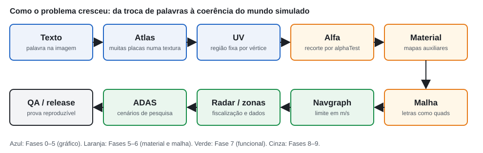

*Figura 2. Como o problema cresceu ao longo das fases: da troca de palavras numa imagem à coerência entre placa, dados do mapa, comportamento da simulação e pacote distribuído. As cores indicam a fase em que cada camada foi tratada.*

Essa evolução é uma das histórias centrais deste artigo. A localização visual e a localização funcional acabaram sendo o mesmo problema, visto de dois lados.

### 2.2 Problema central

O problema pode ser enunciado assim: **como adaptar o conteúdo visual e funcional de um mapa de simulação a outra cultura sem degradar os assets, sem modificar a instalação do jogo, mantendo placa, dados e comportamento coerentes entre si, e entregando o resultado como um pacote verificável?**

## 3. Objetivos

O objetivo geral foi localizar visual e funcionalmente o West Coast USA para o português brasileiro, com integridade técnica dos assets e coerência entre o que o jogador vê e o que a simulação faz.

Os objetivos específicos foram:
1. Traduzir a sinalização e os textos visíveis segundo regras explícitas.
2. Adaptar a sinalização regulamentar ao padrão brasileiro quando houver equivalente claro.
3. Converter unidades (mph → km/h, milhas → metros, galão → litro) e formatos (vírgula decimal, R$).
4. Preservar formatos de compressão, canais alfa, mapas auxiliares e coordenadas UV dos originais.
5. Manter a coerência funcional: placa = via = tráfego = radar = zona = missão = ADAS de limite.
6. Automatizar a validação técnica dos arquivos e o QA visual e funcional no jogo.
7. Nunca alterar a instalação do jogo; garantir que desativar o mod devolva o original.
8. Entregar um pacote reproduzível, só com o necessário para o jogo, testado como o usuário o instalaria.

## 4. Método e linha do tempo

O projeto foi dividido em fases curtas. Cada fase terminou com commit, relatório e critérios de aprovação, e uma fase só começava depois de a anterior estar comprovada. As fases 0 a 5 foram documentadas na primeira edição deste artigo. A Tabela 1 resume a história completa.

*Tabela 1. Fases do projeto (datas dos commits; fuso −03:00).*

| Fase | Datas | Commits principais | Entrega | Documento |
|---|---|---|---|---|
| 0 — Estrutura | 30/09 | `8d10748` | repositório, manifesto SHA-256 dos originais, inventário de famílias | `docs/inventory/` |
| 1 — PoC do *override* | 30/09 | `107e849` | uma textura substituída por mod; teste ON/OFF/ON | `docs/BEAMNG_OVERRIDE_POC.md` |
| 2 — QA automatizado | 30/09 | `50911d5` | runner MCP, catálogo de câmeras, presets, reprodutibilidade | `tests/reports/t_roadsigns_automation_test.md` |
| 3 — Regras de localização | 30/09 | `511b91e` | `LOCALIZATION_RULES.md`, matriz de 308 entradas | `docs/localization/` |
| 4 — Validador | 30/09 | `0256004` | `validate.py`: texturas, DDS, famílias, mod, velocidades | `tests/reports/validation_baseline.md` |
| 5 — Primeira produção | 30/09–01/10 | `f83e4ce`…`70329b1` | atlas `t_roadsigns`, R-19 10/40, 101 vias | `docs/production/PHASE5_ROADSIGNS.md` |
| 5.5 — Primeiro artigo | 02/10 | `56f37b2`, `adbf71c` | artigo técnico (snapshot das Fases 0–5) | `docs/article/` |
| 6 — Produção visual | 05–06/10 | `e117588`…`1e44b9a` | todas as famílias usadas; 25 letreiros de glifos; v0.6.0 | `docs/production/PHASE6_VISUAL_PRODUCTION.md` |
| 7 — Integração funcional | 06–13/10 | `45107a6`…`1973cdb` | limites, radares, zonas, slotTraffic, ADAS, combustível; v0.7.0 | `docs/production/PHASE7_FUNCTIONAL_INTEGRATION.md` |
| 8 — QA global e usuários | até 21/10 | — (fora do repositório) | aceite externo da versão 0.7.0 | `docs/production/PHASE8_GLOBAL_QA.md` |
| 9 — Release 1.0.0 | 21/10 | `12da2c5`…`b4a7450` | build reprodutível, instalação limpa, tag `v1.0.0` | `docs/release/` |

Três princípios atravessaram todas as fases:
- **A base é sempre o original do jogo**, conferido por SHA-256. Traduções anteriores servem só como consulta de texto.
- **Toda mudança precisa de evidência técnica de onde pode acontecer:** a coordenada UV de uma malha instanciada no mapa, o dado de um decalque ou o objeto do nível.
- **Nenhuma afirmação vale sem prova reproduzível:** relatório do validador, captura com câmera salva ou consulta ao jogo.

## 5. Estado inicial

### 5.1 O que existia

A auditoria de 30/09/2026 (`docs/AUDITORIA_PROJETO_TRADUCAO.md`, mantida como *snapshot* imutável) encontrou uma pasta de trabalho sem versionamento, com:
- **35 texturas originais** extraídas do jogo, cada uma em DDS (o formato que o jogo carrega) e em PNG (para edição);
- **13 PNG "PT-BR"** com sufixo `_ptbr`. Eles correspondem a 11 texturas traduzidas, 1 máscara de opacidade e 1 arquivo idêntico ao original (`t_sealbrik_logo`, mesmo hash): uma "tradução" que não traduzia nada;
- um guia antigo que mandava exportar tudo em BC7.

Não havia DDS em português, nenhum mod montado, nenhum teste no jogo, nenhum controle de versão e nenhum arquivo em camadas.

### 5.2 41 ocorrências ou 35 texturas?

A auditoria registrou "41 texturas". Ao montar o manifesto da Fase 0 (`docs/inventory/original_files_manifest.csv`), com um hash por arquivo, apareceram **35 DDS** distintos. A diferença vinha da forma de contar: o número 41 contava **ocorrências nos zips do jogo**, e algumas texturas aparecem em mais de um zip.

A correção continua válida na 1.0.0, e o padrão se repetiu no projeto: um número herdado precisa ser reconferido na fonte primária antes de virar base de decisão. O mesmo aconteceu com as "37 placas de 5 mph", que eram 7 (seção 13.4), e com a contagem de arestas do navgraph, verificada de novo nesta edição (seção 16.2).

### 5.3 Onde as texturas ficam

Quase todas as texturas com texto ficam em **assets globais** (`content/assets/materials/*.zip`), e não no zip do mapa. Substituir uma delas muda a textura em qualquer mapa que a use. Essa característica orientou a política de escopo e é uma das limitações registradas na 1.0.0 (seção 23).

## 6. Auditoria das primeiras traduções

### 6.1 Imagens regeneradas

Uma edição que só troca palavras altera uma fração pequena dos pixels. A auditoria comparou cada original com seu `_ptbr`, amostrando a cada 4 pixels com tolerância 12 (Tabela 2).

*Tabela 2. Pixels alterados nas traduções antigas (auditoria, amostragem 1:4, tolerância 12).*

| Textura | Pixels alterados | Alteração forte |
|---|---:|---:|
| `ind_industrial_signs_d` | 77,8% | 21,2% |
| `t_movie_studio_signage_b` | 65,2% | 27,6% |
| `t_billboardsigns_dealers_b` | 51,5% | 16,9% |
| `billboards_d` | 50,2% | 7,5% |
| `t_eca_genericsigns_b` | 50,0% | 31,6% |
| `t_decal_roadmarkings_b` | 49,9% | 14,0% |
| `t_roadsigns_b` | 45,4% | 17,5% |
| `t_sponsors_b` | 32,7% | 1,7% |
| `eca_roadsigns_d` | 31,6% | 8,1% |
| `t_steel_factory_brand_b` | 26,0% | 6,6% |
| `t_spearleaf_refinery_logo_b` | 25,9% | 15,5% |

Mudanças de 26% a 78% só se explicam pela imagem inteira redesenhada. Sujeira, desgaste e cores de áreas sem texto mudaram, e deixaram de combinar com os mapas de relevo e rugosidade originais. O validador da Fase 4 refez a medição com todos os pixels e tolerância 2, e os valores subiram (por exemplo, 95,2% em `ind_industrial_signs_d`). As duas medições não se contradizem; usam critérios diferentes.

### 6.2 O que importa é onde a imagem mudou

A medida decisiva não é quantos pixels mudaram, e sim **onde**. O validador compara as mudanças com **regiões autorizadas**: retângulos do atlas com prova técnica de onde cada elemento fica (seção 18). No atlas de placas `t_roadsigns`, a tradução antiga alterou 59,88% dos pixels **fora** das 44 regiões confirmadas na Fase 5. A reconstrução da Fase 5 alterou zero.


*Figura 3. Figura reutilizada da primeira edição (Figura 2 de `docs/article/`). Mapas de calor gerados por `validate.py texture` sobre `t_roadsigns_b.color`. Vermelho: pixel alterado. Verde: contorno das 44 regiões autorizadas. (A) Tradução antiga: mudanças em praticamente todo o atlas, 59,88% fora das regiões; FAIL. (B) Atlas reconstruído na Fase 5: 188.445 px dentro, 0 px fora; PASS. Na 1.0.0 o atlas ganhou mais 29 tiles em espaço livre (Fases 6 e 7), e os 44 elementos da Fase 5 continuam idênticos byte a byte.*

### 6.3 Deslocamento de UV, alfa e mapas auxiliares

Os outros defeitos encontrados na auditoria foram:
- **Deslocamento.** No atlas antigo, a borda esquerda do octógono do STOP passou de x = 1167 para x = 1177: 10 pixels numa região de 126, cerca de 8% da placa. As malhas continuam lendo a mesma região, então a placa aparece cortada no jogo (Figuras 4 e 8).
- **Perda e ruído de alfa.** O *canal alfa* guarda a transparência de cada pixel, de 0 (transparente) a 255 (opaco). Em `eca_roadsigns_d`, o original tinha 11,64% de pixels transparentes e a tradução antiga, 0%. Em `t_billboardsigns_dealers_b`, todos os pixels de alfa 0 viraram opacos. Todas as traduções antigas ganharam ruído no alfa, com mínimos de 193 a 221 onde o original era 255 (Figura 5).
- **Emissivo incompatível.** O mapa *emissivo* define o que brilha à noite. O emissivo de `eca_genericsigns` não acompanhava o novo desenho da cor.
- **Marcações no asfalto incompletas.** Só a cor foi traduzida; a máscara que recorta as letras continuava com as palavras em inglês (seção 9.3).


*Figura 4. Figura reutilizada da primeira edição (Figura 4). Região do R-1 no atlas, ampliada 3× sem interpolação; o contorno ciano é a região UV amostrada pelas malhas (x 1164–1290, y 231–358). (A) Original. (B) Tradução antiga, com o octógono deslocado. (C) Reconstrução da Fase 5, que mantém o octógono pixel a pixel e só muda a legenda.*


*Figura 5. Figura reutilizada da primeira edição (Figura 8). Canal alfa em tons de cinza (preto = transparente). (A) e (C) originais de `eca_roadsigns_d` e `t_billboardsigns_dealers_b`, com recortes por alfa. (B) e (D) traduções antigas, totalmente opacas.*

### 6.4 O que as traduções antigas acertaram

As traduções antigas não eram inúteis. A revisão textual da Fase 3 (`docs/localization/legacy_translation_review.md`) separou o **texto** da **arte** e avaliou cada frase contra as novas regras (Tabela 3).

*Tabela 3. Veredictos da revisão textual das traduções antigas (160 itens).*

| Veredicto | Itens | Significado |
|---|---:|---|
| manter | 97 | texto reaproveitável como está |
| corrigir | 40 | ajuste de forma: ordem do logradouro, "R$ 200", "2 h" |
| substituir | 16 | contraria uma regra: R-2 com texto, marca traduzida, "RON" |
| investigar | 7 | dependia de contexto ainda não confirmado |

Cerca de 61% dos textos foram mantidos. A conclusão, que não era óbvia no início, valeu até a 1.0.0: **a arte antiga não servia como master, mas o vocabulário era em boa parte bom.** Termos como CONTRAMÃO, PROIBIDO ESTACIONAR e NÃO BLOQUEIE O CRUZAMENTO foram reaproveitados e redesenhados sobre os originais.

---

# Parte II — Arquitetura

## 7. Substituição pelo sistema de arquivos virtual

### 7.1 Como o jogo encontra um arquivo

O BeamNG não lê os assets direto do disco. Ele usa um **sistema de arquivos virtual (VFS)**, que monta numa árvore única os zips da instalação (`content/…`), os arquivos soltos do jogo e os mods ativos do usuário. Quando o motor pede `/assets/materials/signage/roadsigns/t_roadsigns_b.color.dds`, o VFS decide de qual origem entregar o arquivo:

```text
o jogo pede um caminho virtual
        ↓
VFS procura o caminho entre os mods ativos
        ↓ (encontrou)              ↓ (não encontrou)
arquivo do mod             arquivo original do jogo
```

A hipótese da Fase 1 foi esta: um arquivo com **o mesmo caminho virtual e o mesmo nome**, dentro de um mod, tem precedência sobre o zip do jogo. Se isso fosse verdade, nada precisaria mudar na instalação, nem nos materiais, nem nas malhas: o mod seria uma árvore que espelha os caminhos do jogo, e desativá-lo devolveria o original.

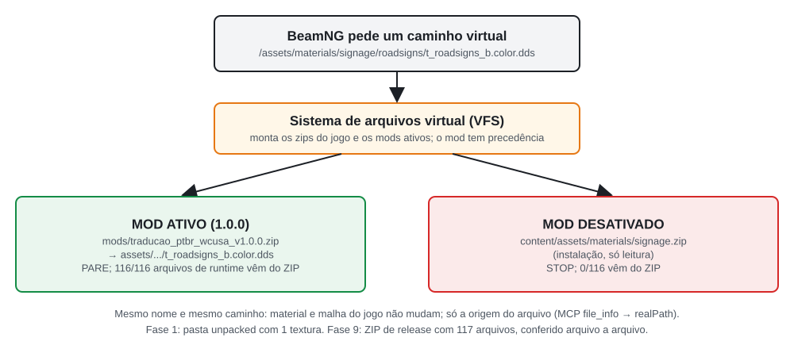

*Figura 6. Resolução do caminho virtual de uma textura, atualizada para a versão 1.0.0. Com o ZIP de release ativo, o VFS entrega o arquivo de dentro do ZIP; desativado, entrega o arquivo do zip da instalação. A origem real foi conferida pela ferramenta MCP `file_info` (campo `realPath`) e por `FS:getFileRealPath` para todos os 116 arquivos de runtime do pacote (seção 20.5).*

### 7.2 A prova de conceito

A Fase 1 montou um mod mínimo, só com o DDS do atlas, em `current/mods/unpacked/traducao_ptbr_wcusa/`, e alternou o estado três vezes:

```text
mod ON  + recarga → PARE
mod OFF + recarga → STOP
mod ON  + recarga → PARE
```


*Figura 7. Figura reutilizada da primeira edição (Figura 7): capturas originais da Fase 1 (30/09/2026, `tests/screenshots/poc/`). (A) Mod ativo. (B) Mod desativado e mapa recarregado. (C) Mod reativado.*

O experimento provou que o caminho de substituição existe, que é reversível e que o formato do DDS (BC7 sRGB, 2048 × 1024, 12 mipmaps) é aceito. Ele **não** provou que a tradução estava boa: a textura usada era a antiga, e o defeito de UV apareceu no jogo. O PoC foi registrado como "override técnico validado; tradução não aprovada".

Olhando de volta, esse teste de três estados foi o primeiro experimento de uma arquitetura que terminou numa release: o mesmo princípio de mesmo caminho, mesmo nome e mod reversível sustenta os 117 arquivos do pacote 1.0.0. A Figura 8 mostra o mesmo ponto de QA em três momentos, na mesma câmera.


*Figura 8. Ponto de QA `roadsigns_chinatown_stop`, câmera de catálogo, preset diurno. (A) Original, capturado em 21/10/2026 com o ZIP desativado. (B) PoC da Fase 1, reproduzido em 02/10/2026 para a primeira edição (`docs/article/figures/raw/`): a faixa cinza à esquerda e o "E" cortado vêm do deslocamento do atlas antigo. (C) Versão 1.0.0, capturada em 21/10/2026 com somente o ZIP. As capturas de 1920 × 1080 (2026-10-21) e 1920 × 993 (2026-10-02) usam o mesmo FOV vertical e foram levadas ao mesmo quadro (procedimento em `METHODOLOGY_NOTES_FINAL.md`). Ao fundo de (C), o cartaz de liquidação mostra OFERTA%, da Fase 6.*

### 7.3 Decisão

| Etapa | Conteúdo |
|---|---|
| **Problema** | substituir arquivos do jogo sem quebrar a instalação e de forma reversível |
| **Alternativas** | (a) editar os zips do jogo; (b) criar materiais novos com outros nomes; (c) arquivo de mesmo caminho virtual num mod |
| **Riscos** | (a) destrutivo e perdido a cada atualização; (b) redefinir materiais do jogo; (c) depende de um comportamento não documentado do VFS |
| **Decisão** | (c), validada experimentalmente antes de qualquer produção |
| **Consequência** | o mod espelha caminhos virtuais; o nome é sempre o original, nunca `_ptbr`; o *override* vale para todos os mapas que usam o mesmo arquivo |

## 8. Cache: o que sobrevive ao desligar o mod

A Fase 1 mostrou a substituição funcionando. As fases seguintes mostraram que provar o estado "mod desligado" é mais difícil do que parece. Três armadilhas apareceram, cada uma capaz de produzir um falso resultado:

1. **Recarregar o mesmo mapa não limpa tudo.** Na Fase 5, com o mod desligado e o West Coast recarregado, a placa continuava PT-BR: texturas, malhas compiladas e dados do nível ficavam na sessão. Carregar **outro** mapa (`smallgrid`) antes de voltar ao West Coast resolveu.
2. **Malhas compiladas no cache do usuário.** O BeamNG carrega a malha a partir de um arquivo COLLADA (`.dae`) e guarda uma versão compilada (`.cdae`). Se o mod traz um `.dae` mais novo que o `.cdae` disponível, o motor compila e grava o resultado em `current/temp/`, e esse arquivo **continua valendo com o mod desligado**. Na Fase 6, 25 `.cdae` compilados durante o desenvolvimento faziam o estado "mod desligado" mostrar letreiros em português, até serem apagados do cache.
3. **Datas no pacote.** A solução foi distribuir o `.cdae` compilado pelo próprio jogo, com data posterior à do `.dae`. Na Fase 9 isso virou uma regra do build: dentro do ZIP, todo `.cdae` é gravado 2 minutos depois do seu `.dae`. Em 21/10/2026, depois de carregar o West Coast só com o ZIP, o cache não tinha nenhum `.cdae` dos 32 caminhos de malha do pacote.

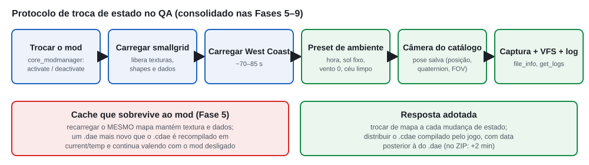

*Figura 9. Protocolo de troca de estado usado do QA da Fase 5 em diante. Cada mudança de estado do mod passa por outro mapa, e o pacote distribui malhas compiladas mais novas que as fontes. O protocolo foi aplicado sem mudança no teste do ZIP de release (Fase 9) e nas capturas desta edição.*

Esses achados tornaram o QA mais lento: cada troca de estado custa duas cargas de mapa, cerca de 70 a 85 s cada. Em troca, o QA ficou confiável. Todos os testes de "mod desligado" deste artigo seguem o protocolo da Figura 9.

---

# Parte III — Pipeline gráfico

## 9. Formatos, alfa e mapas auxiliares

### 9.1 DDS e compressão em blocos

O **PNG** é um formato sem perdas, bom para editar e comparar pixels. O jogo carrega **DDS** (*DirectDraw Surface*), um contêiner que guarda a textura já no formato que a placa de vídeo usa: comprimida em blocos e com **mipmaps**, que são cópias reduzidas (½, ¼… até 1 × 1) usadas quando o objeto está longe. No pipeline, o PNG é o intermediário editável e o DDS é o artefato final, gerado com o `texconv` da Microsoft (DirectXTex).

Os formatos BC (*block compression*) dividem a imagem em blocos de 4 × 4 pixels de tamanho fixo ([Microsoft, *Texture Block Compression in Direct3D 11*](https://learn.microsoft.com/en-us/windows/win32/direct3d11/texture-block-compression-in-direct3d-11)):

| Formato | Conteúdo | Bytes por bloco |
|---|---|---:|
| **BC1** (DXT1) | cor RGB 5:6:5, alfa de 1 bit | 8 |
| **BC3** (DXT5) | cor + alfa de 8 bits | 16 |
| **BC4** | um canal | 8 |
| **BC5** | dois canais (mapas de normais) | 16 |
| **BC7** | cor de alta qualidade, alfa opcional | 16 |

A cor pode ser **sRGB** (codificada com a curva de gama da tela) ou **linear**. sRGB é certo para cor e errado para dados: uma máscara de opacidade, um mapa de rugosidade ou de normais guarda números, que precisam ser lidos sem conversão.

O guia antigo mandava exportar tudo em BC7. O manifesto mostrou que os 35 originais usam cinco variantes: 21 BC7 sRGB, 2 BC7 linear, 3 BC4, 5 BC3 e 4 BC1. "Tudo em BC7" dobraria o tamanho das texturas BC1/BC4 e, com sRGB escolhido sem critério, corromperia mapas de dados. A regra adotada (`docs/TEXTURE_GUIDELINES.md`, Regras 2 a 6) foi **manter o formato, o espaço de cor, a resolução e a cadeia de mipmaps de cada original**. O validador recusa um BC7 linear no lugar de um sRGB, um mapa `_o.data` marcado como sRGB e um DDS truncado.

Na 1.0.0, os 31 DDS do pacote seguem essa regra (Apêndice A):
- 17 em BC7 sRGB (cor);
- 1 em BC7 linear (a opacidade do atlas de placas, como no original);
- 9 em BC4 (opacidade, oclusão e rugosidade);
- 4 em BC5 (mapas de normais extraídos na Fase 6).

### 9.2 Alfa e alphaTest

Muitos materiais de placa não misturam transparência; usam **alphaTest**: o pixel é desenhado se o alfa for maior ou igual a um limiar (`alphaRef`) e descartado se for menor. O material `roadsigns` usa 128; o das marcações no asfalto, 8; o logotipo da refinaria, 135. Com alphaTest, pequenas mudanças de alfa têm efeito binário: um pixel opaco que cai abaixo do limiar abre um furo; um transparente que vira opaco desenha um fundo em volta da placa.

A regra resultante foi que o alfa final vem do original, ou de uma máscara refeita quando a forma da letra muda. Na reconstrução do atlas de placas, a diferença média de alfa ficou em zero.

### 9.3 Mapas auxiliares: o caso das marcações no asfalto

Um material moderno do BeamNG combina vários mapas:
- **cor base** (`_b.color`);
- **opacidade** (`_o.data`);
- **normal** (`_nm.normal`): o *normal map* guarda o relevo fino, como a borda da tinta;
- **oclusão ambiente** (`_ao.data`): sombreamento de cavidades;
- **rugosidade** (`_r.data`);
- **metálico** (`_m.data`);
- **emissivo**: o que brilha à noite.

O projeto chama esse conjunto de **família**. Se a cor muda de forma, os outros mapas da família, desenhados para a forma antiga, deixam de combinar.

As marcações no asfalto são o exemplo mais claro. O mapa de cor é um cinza quase uniforme com textura de tinta gasta; quem recorta "STOP" do asfalto é a **opacidade**. A tradução antiga alterou só a cor. No jogo, "PARE" apareceria recortado pelo contorno de "STOP". Além disso, não existem frases no atlas: cada **decalque** (uma imagem projetada sobre o pavimento) mostra **uma célula** de uma grade 4 × 4, e o mapa posiciona decalques vizinhos para formar "KEEP CLEAR" ou "BUS ONLY".


*Figura 10. Figura reutilizada da primeira edição (Figura 9). Atlas `t_decal_roadmarkings_b.color` dividido na grade 4 × 4 de `managedDecalData.json`, com o índice de cada célula (`rectIdx`) e o número de instâncias no `main.decals.json` do West Coast. Mostra o problema como era na Fase 5, antes da produção.*


*Figura 11. Mapa de opacidade `t_decal_roadmarkings_o.data` (cópia `decalroad/lines/roadmarkings1`, 1024 × 1024) em tons de cinza, com a grade das células. (A) Original. (B) Versão 1.0.0: STOP → PARE, KEEP → NÃO, CLEAR → BLOQUEIE, NO → SEM, EXIT → SAÍDA, BUS → ÔNIBUS, ONLY → SÓ. LEFT e TURN não têm nenhuma instância no mapa e ficaram como estavam. A Fase 6 refez também a normal e a oclusão dessas células, nas duas cópias do atlas que o jogo carrega.*

## 10. Master reproduzível

A mudança metodológica mais importante do projeto foi abandonar a edição destrutiva: abrir uma imagem, pintar, salvar. Cada asset localizado passou a ser **o resultado de um script aplicado ao original**:

```text
original do jogo (SHA-256 conferido)
+ regiões com evidência UV
+ master declarativo (texto, fonte, cor, caixa)
+ scripts determinísticos
= asset localizado, reproduzível
```

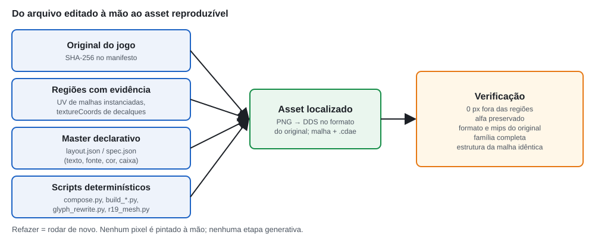

*Figura 12. O master reproduzível: o asset final é sempre recalculado a partir do original e de decisões versionadas, e conferido pelo validador.*

As ferramentas que implementam esse método foram construídas ao longo das fases:
- **`working/layered/t_roadsigns/build_t_roadsigns.py`** (Fase 5): reconstrói o atlas de placas a partir de um `layout.json`. Detecta a legenda antiga por cor, preenche o fundo por difusão a partir dos vizinhos, reaplica o grão original e desenha o texto novo. Fora das regiões, o PNG é cópia pixel a pixel do original.
- **`tools/production/compose.py`** (Fase 6): compositor genérico de painéis. Inclui apagamento girado e em anel, texto girado e em arco, recorte da opacidade (`cutout`) e mapas de normais refeitos a partir do texto novo (`gradient_normal`).
- **`tools/production/dae_uv.py` e `asset_usage.py`**: leem as malhas COLLADA do jogo, calculam a pegada UV de cada malha instanciada no mapa e respondem quais regiões de um atlas o West Coast realmente mostra.
- **`tools/production/export_family.py`**: converte PNG em DDS no formato e com os mipmaps de cada original.
- **`working/layered/r19/build_r19.py` e `tools/production/r19_mesh.py`**: geram as placas R-19 (textura, máscara e malha) para qualquer valor.
- **`tools/production/glyph_signs.py`, `glyph_rewrite.py` e `glyph_sync.py`**: leem, renderizam e reescrevem letreiros cujas letras são quadriláteros da malha (seção 15.9).
- **`tools/production/apply_phase7_functional.py`**: gera, de uma vez, todos os dados funcionais do nível (Parte VI).

Duas regras protegem o método. A primeira: **nenhuma etapa generativa**. O preenchimento é sempre feito por difusão a partir dos pixels vizinhos, e o texto é desenhado com fontes do sistema. A segunda: **regiões só com evidência**. Uma região entra em `allowed_regions.json` se uma malha instanciada no mapa a amostrar, ou se um decalque a usar, e nunca é ampliada para o validador passar.

---

# Parte IV — Localização

## 11. Tradução versus localização

Traduzir `STOP` como `PARE` é simples: os dois países usam um octógono vermelho com uma palavra. Isso é **tradução**.

Já `SPEED LIMIT 25` (mph) exige outra coisa. "LIMITE DE VELOCIDADE 25" mantém um formato de placa que não existe no Brasil. "25 km/h" muda o significado: 25 mph são cerca de 40 km/h. A solução correta foi:

```text
SPEED LIMIT 25 (mph)  →  R-19 40 km/h  +  via a 11,1111 m/s  +  navgraph a 40  +  IA a 40
```

Isso é **localização funcional**: a placa, o dado do mapa e o comportamento da simulação passam a dizer a mesma coisa. Uma tradução só da imagem diria "40 km/h" enquanto a IA continuaria andando a 60. Para o jogador, seria uma placa que mente. Para um experimento de condução, seria uma regra ambígua.

A hierarquia de decisão (`LOCALIZATION_RULES.md` §0) foi:
1. preservar o **significado funcional** do elemento;
2. usar **português brasileiro natural**, nunca palavra por palavra;
3. seguir a **convenção brasileira** quando houver equivalente claro (MBST/CONTRAN);
4. **preservar nomes próprios fictícios**: marcas, empresas e lugares;
5. **adaptar unidades e convenções**: km/h, m, R$, vírgula decimal, 24 h.

## 12. Sinalização brasileira e velocidades

### 12.1 Sinais regulamentares

As decisões regulamentares seguem o MBST, Volume I (Sinalização Vertical de Regulamentação), citado pela página do PDF:
- **R-1, Parada obrigatória:** `STOP` → **PARE**, letras brancas sobre o octógono vermelho (MBST-I p.15). A legenda foi refeita sobre o octógono original, intacto pixel a pixel.
- **R-2, Dê a preferência:** triângulo invertido de fundo branco e orla vermelha, **sem legenda**. Informação complementar não é admitida no R-1 nem no R-2 (MBST-I p.13, §4.3.1). A tradução antiga espremia "DÊ A PREFERÊNCIA" dentro do triângulo, e foi substituída (Figura 13).
- **R-3, Sentido proibido:** `DO NOT ENTER` → disco vermelho com barra branca, **sem texto**.
- **R-19, Velocidade máxima permitida:** placa circular de fundo branco, orla vermelha, algarismos pretos e "km/h" abaixo do número (MBST-I/2005 p.193), sem "LIMITE DE VELOCIDADE" escrito.

Outras placas seguem o glossário do projeto. `SPEED CAMERA` / `PHOTO ENFORCED` viraram FISCALIZAÇÃO ELETRÔNICA, e `CARPOOLS ONLY` virou FAIXA EXCLUSIVA / 2 OU MAIS OCUPANTES (nunca "carona", que no Brasil tem outro sentido).


*Figura 13. Ponto `roadsigns_downtown_yield`, câmera de catálogo. (A) Original, com o ZIP desativado (21/10/2026). (B) Referência antiga, reproduzida para a primeira edição (02/10/2026): texto no triângulo e triângulo deslocado. (C) Versão 1.0.0, só o ZIP: R-2 sem legenda, com o contorno do original. Ao fundo, a placa RENT-A-BOX mostra GUARDA-VOLUMES, produzida na Fase 6.*

### 12.2 Da milha por hora ao metro por segundo

A conversão de velocidade tem três etapas. A relação entre as unidades é exata, mas uma placa brasileira com "40,23" não existe: o MBST-I determina que a velocidade regulamentada tenha **valores múltiplos de 10** (MBST-I p.35). Os sistemas internos do jogo, por sua vez, usam **metros por segundo**.

```text
25 mph × 1,609344 = 40,23 km/h      (conversão exata)
         ↓
40 km/h                             (múltiplo de 10 mais coerente com o tipo de via)
         ↓
40 ÷ 3,6 = 11,1111 m/s              (valor gravado no mapa)
```

Duas regras completam a conversão. Primeiro, quando dois limites diferentes caem no mesmo valor no mesmo contexto, o maior sobe para o múltiplo seguinte, para não apagar a distinção entre tipos de via. Segundo, **nada de conversão encadeada**: o valor em m/s é calculado a partir do km/h escolhido. O valor herdado 11,176 m/s (25 mph exatos) apareceria como 40,2 km/h e seria reprovado pelo validador.

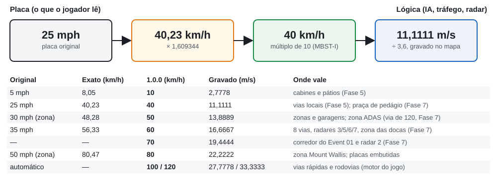

*Figura 14. Da placa em mph ao valor gravado no mapa, com os valores realmente usados na versão 1.0.0 e onde cada um vale. Na primeira edição esta figura listava a regra; aqui lista o que foi implementado.*

### 12.3 Tabela final de velocidades

A Tabela 4 resume os limites da 1.0.0. A coluna "visual" indica a placa que o jogador vê.

*Tabela 4. Limites de velocidade na versão 1.0.0 (fontes: `working/speed/speed_changes.json`, `working/functional/speed_changes.json`, navgraph lido no jogo em 21/10/2026).*

| km/h | m/s | Visual | Contexto |
|---:|---:|---|---|
| 10 | 2,7778 | R-19 10 (7 placas, malha própria) | cabines das docas e pátios (18 vias, Fase 5) |
| 20 / 30 / 40 / 50 | — | advertência amarela "nn km/h" | 24 placas de curva (ex-15/20/25/30 MPH), sem efeito funcional |
| 30 | 8,3333 | — | limite automático do motor em vias estreitas, preservado |
| 40 | 11,1111 | R-19 40 (11 placas de malha; 2 placas embutidas; cabines do pedágio) | 83 vias locais (Fase 5) e 5 faixas da praça de pedágio (Fase 7) |
| 50 | 13,8889 | R-19 50 (4 placas novas) | DR312, zona do ADAS Speed Alert; zonas residenciais (dado) |
| 60 | 16,6667 | R-19 60 (5 placas embutidas) | 8 vias ex-35 mph; radares 3, 5, 6 e 7; zona das docas |
| 70 | 19,4444 | R-19 70 (2 placas novas) | DR652, corredor do Event 01; radar 2 |
| 80 | 22,2222 | R-19 80 (3 placas embutidas) | automático; zona Mount Wallis (dado) |
| 100 | 27,7778 | R-19 100 (8 placas embutidas) | automático; radar 4 |
| 120 | 33,3333 | R-19 120 (5 embutidas + 1 nova) | automático; DR758 explícito na saída da zona ADAS |

Uma ressalva honesta: na Fase 3, a consulta ao navgraph mostrou que **96% do mapa já estava em múltiplos de 10 km/h**. Os limites automáticos do motor (`lua/ge/map.lua`) são métricos: 30, 50, 60, 80, 100 e 120. Só 355 arestas tinham valores herdados de mph. Localizar velocidades, portanto, não foi converter o mapa inteiro, mas encontrar e corrigir as exceções, e fazer as placas e os sistemas paralelos (radares, zonas, tráfego) concordarem com o que o motor já fazia.

## 13. O R-19 e os glifos compartilhados

### 13.1 A descoberta

A expectativa inicial era localizar a placa de velocidade como as outras: editando a região do atlas. A análise das malhas `sign_speed25.dae` e `sign_speed5.dae` mostrou que **não há região da placa no atlas**. A malha monta a placa com quatro peças apontadas por UV: um painel branco genérico, um *tile* "SPEED LIMIT" e dois algarismos da linha de algarismos do topo do atlas. Essa linha é a mesma usada pelos números das baias do porto, pelo pedágio, pelos túneis e pelas placas de velocidade do pórtico. Trocar o "2" e o "5" para formar "40" mudaria todos os números do mapa.

### 13.2 Decisão: R-19 com asset próprio

A decisão da Fase 5 foi criar uma família nova, `roadsigns_ptbr_r19`, com escopo de nível (só West Coast):
- **textura** de cor por valor, 512 × 1024, cobrindo o painel inteiro;
- **uma máscara de opacidade compartilhada** com o disco;
- **materiais** com os mesmos parâmetros do original (alphaTest 128, retrorrefletividade);
- **malhas** que mudam só material e UV. Topologia, contagem de triângulos e caixa delimitadora ficam idênticas ao original, o que é verificado por hash dos arrays de posições, normais, cores e índices.


*Figura 15. Figura reutilizada da primeira edição (Figura 17). (A) Textura de cor do R-19 40. (B) Máscara compartilhada. (C) e (D) Recorte por alphaTest 128 para 40 e 10 km/h.*

A primeira UV saiu girada 180° e a segunda, espelhada. Em vez de supor uma orientação, o gerador de malhas passou a deduzi-la dos quadriláteros de texto da placa original, e a orientação foi conferida no render offline e no jogo.

### 13.3 As variantes da versão 1.0.0

Na 1.0.0, o mod distribui **cinco** texturas R-19 (10, 40, 50, 70 e 120 km/h), conferidas em `mod/traducao_ptbr_wcusa/levels/west_coast_usa/art/shapes/objects/roadsigns_ptbr/`. Quatro delas têm malha própria (`sign_r19_10`, `_50`, `_70`, `_120`); o R-19 40 usa a malha `sign_speed25.dae` substituída no mesmo caminho. As variantes 50, 70 e 120 foram criadas na Fase 7 com o mesmo gerador da Fase 5. Os números de três dígitos usam a largura mais estreita da mesma fonte, e as saídas de 10 e 40 ficaram idênticas byte a byte.


*Figura 16. As cinco texturas R-19 do pacote (`working/png/r19/`), recortadas em torno do disco e levadas à proporção física da placa (0,7317 × 1 m numa textura de 512 × 1024, com texels não quadrados). O vermelho fora do disco tem a cor da orla para não criar halo nos mipmaps; no jogo, ele é cortado pela máscara de opacidade.*

Os R-19 60, 80 e 100 vistos no mapa não são malhas próprias: são as faces novas das 23 placas embutidas no `roadsigns.dae`, criadas na Fase 7 (seção 16.5).

### 13.4 Resultado negativo: as placas das baias do porto

Para o R-19 40, a malha `sign_speed25.dae` foi substituída no mesmo caminho virtual, e as 11 instâncias mudaram sem editar o mapa. Fazer o mesmo com `sign_speed5.dae` transformou 30 placas cinza de fundo dos números das baias do porto em discos R-19: o mapa tinha 37 instâncias dessa malha, mas só 7 eram placas de velocidade.


*Figura 17. Figura reutilizada da primeira edição (Figura 18). (A) Original × mod com `sign_speed5.dae` substituído: a placa do número "24" virou um disco. (B) Original × mod corrigido.*

A correção foi criar a malha `sign_r19_10.dae` e trocar o `shapeName` só nas 7 placas reais. As decisões funcionais tiradas da contagem errada também foram revertidas: 29 caminhos do porto que tinham ido a 10 km/h voltaram ao automático. A regra ficou permanente em `WORKFLOW.md`: **uma malha só pode ser substituída no mesmo caminho se todas as instâncias forem o objeto que se quer trocar.**

## 14. Outras convenções

### 14.1 Moeda

| Etapa | Conteúdo |
|---|---|
| **Problema** | preços em dólar ("4.99-", "$400 FINE", "SAVE UP TO $200") |
| **Alternativas** | manter "$"; converter pelo câmbio; trocar símbolo e formato mantendo o número |
| **Decisão** | **R$ sem conversão cambial**, no formato brasileiro: `$4.99 → R$ 4,99`, `$400 → R$ 400` |
| **Motivo** | o câmbio desatualiza no dia seguinte, alonga os números (que deixam de caber na arte) e transforma localização em simulação econômica; o mod fica atemporal |

A regra vale para a arte. O dinheiro do jogo (economia, custo do abastecimento) não muda. Nos letreiros montados por glifos, o "$" virou "R$" acrescentando um quadrilátero de letra (seção 15.9).

### 14.2 Combustível

O atlas dos postos mostra "MINIMUM OCTANE RATING (R+M)/2 METHOD 87 / 89 / 93". A tradução antiga escreveu "OCTANAGEM MÍNIMA (RON) 87/89/93", o que é tecnicamente errado. Nos EUA, o número afixado na bomba é o **AKI** (*Anti-Knock Index*), a média (RON + MON)/2. No Brasil, a referência mais comum é o **RON**, que para o mesmo combustível dá um número maior. Rotular 87 AKI como "RON 87" descreve outro combustível.

A decisão (`LOCALIZATION_RULES.md` §8) foi nunca rotular como RON e usar as categorias comerciais brasileiras: **GASOLINA COMUM (87), ADITIVADA (89) e PREMIUM (93)**, com o rótulo `(R+M)/2` junto do número preservado.

A unidade de combustível é funcional. O `info.json` do nível declarava `"localUnits": {"gasoline": "gallonUS", "diesel": "gallonUS"}`. O código do jogo só reconhece `gallonUS`; qualquer outro valor cai no padrão métrico, e não existe uma string de "litro". A solução mínima da Fase 7 foi **remover a entrada** num override do `info.json`. Os painéis dos postos passaram a mostrar o preço por litro ("136 9/10" em vez de "518 9/10" no posto Trilobite), e o valor cobrado no abastecimento continua o mesmo, porque o preço interno do jogo já é por litro.

### 14.3 Logradouros

Em português, o tipo de logradouro vem antes do nome. A regra (`LOCALIZATION_RULES.md` §4) traduz o tipo e os substantivos comuns e mantém o nome próprio:

| Original | Tradução antiga | Regra |
|---|---|---|
| Brittlebush St | Brittlebush Rua | **Rua Brittlebush** |
| Mojave Rd | Mojave Estrada | **Estrada Mojave** |
| Canal St | Canal Rua | **Rua do Canal** |
| Fjord Street | — | **Rua Fjord** (mapa de ônibus) |
| Belasco Boulevard | — | **Avenida Belasco** (mapa de ônibus) |
| Dockyards | Dockyards Docas | **Docas** |
| Motorsports Park | Motorsports Parque | **Autódromo** |

Na 1.0.0 essas regras aparecem em três lugares: nos painéis de destino do atlas de placas (Estrada Mojave, PRÓXIMA SAÍDA), no mapa de linhas de ônibus (23 paradas) e na missão garageToGarage ("de Docas para Pista de corrida"). Nomes sem tipo de logradouro, como Fog Hill e Sierra Vista, e marcas (Gavril, Nodeoline, Spearleaf, Turbo Burger, Hot Rolled Inc.) ficaram como estão. A tradução antiga havia transformado "HOT ROLLED INC." em "LAMINADOS A QUENTE LTDA.", e isso foi revertido.

### 14.4 Adaptação cultural

O documento `docs/localization/cultural_adaptations.md` registra os casos em que a tradução direta erraria o sentido:
- **Hospedagem:** `MOTEL` → **POUSADA**. No Brasil, "motel" remete a outro tipo de estabelecimento. O letreiro do motel de Mountainview foi refeito na malha (Figura 24).
- **Horários e números:** `OPEN 24 HRS` → ABERTO 24 HORAS; `4.42` → 4,42; `1,499` → 1.499; horários em 24 h. Datas técnicas não foram alteradas.
- **Unidades em placas:** `MAX CLEARANCE 13 FT 1 IN` → ALTURA MÁXIMA 3,9 m no túnel do autódromo; frações de milha dos pórticos → 400 m / 800 m / 1,2 km.
- **Publicidade:** `GOT A LEMON?` → TEM UMA BOMBA? ("lemon" é gíria para carro com defeito); `STORE CLOSING` → QUEIMA TOTAL; `AMERICA'S TRUSTED TIRE BRAND` → "… DE CONFIANÇA DOS EUA". A tradução antiga dizia "do Brasil", o que contradiz o universo americano preservado.
- **Instituições fictícias:** viram "Departamento de Transportes", nunca DETRAN ou SENATRAN. O distintivo `FIRE · FIRWOOD · DEPARTMENT · POLICE` foi preservado.
- **Termos correntes no Brasil:** "% OFF", DRIFT, DIESEL, PRE-STAGE/STAGE da arrancada e PEDICURE/MANICURE foram mantidos.
- **Chinatown:** os caracteres chineses foram preservados; só o inglês das placas bilíngues foi traduzido (NO ENTRY → ENTRADA PROIBIDA).

### 14.5 A matriz de localização

A Fase 3 separou **o que dizer** de **onde fica** e **como desenhar**, com uma tabela de uma linha por texto ou elemento (`docs/localization/LOCALIZATION_MASTER.csv`). Cada linha tem família, textura, texto original, texto PT-BR, unidade, tipo de localização, dependência funcional, **status**, **escopo** e **uso confirmado no West Coast**.

A matriz começou com 308 linhas na Fase 3 e terminou com **323** na 1.0.0. A Tabela 5 mostra a distribuição final.

*Tabela 5. Status das 323 linhas da matriz na versão 1.0.0, cruzado com o uso confirmado no West Coast (`LOCALIZATION_MASTER.csv`, tag `v1.0.0`).*

| Status | Uso confirmado (216) ou provável (1) | Sem uso no West Coast | Total |
|---|---:|---:|---:|
| `qa_passed` (produzido e visto no jogo) | 164 | 0 | 164 |
| `implemented` (produzido e validado, sem ponto de QA próprio) | 11 | 0 | 11 |
| `preserve_original` | 42 | 5 | 47 |
| `rule_defined` / `approved_rule` (regra definida, asset não usado) | 0 | 99 | 99 |
| `needs_context` / `needs_implementation` | 0 | 2 | 2 |
| **Total** | **217** | **106** | **323** |

A leitura importante está na coluna do meio: **todas as 217 linhas com uso confirmado (216) ou provável (1) no West Coast foram produzidas e conferidas no jogo, validadas ou preservadas de propósito**. As linhas ainda abertas são de assets que nenhuma malha ou decalque do West Coast usa. Por exemplo, `eca_plate_40_30_35` vem do atlas do East Coast e `ut_speed_limit`, do atlas de Utah. As regras delas ficaram como referência para um eventual pacote de outros mapas.

O relatório da Fase 6 dizia "0 `needs_context`". Essa afirmação vale para a classificação por **uso** (nenhuma linha usada no West Coast espera contexto), não para a coluna de status. Os dois critérios estão na tabela acima.

---

# Parte V — Produção visual

## 15. Da primeira família à cobertura completa

### 15.1 Fase 5: a primeira família definitiva

A Fase 5 produziu a família `t_roadsigns`, o atlas de 2048 × 1024 com a maior parte da sinalização montada do mapa, e as primeiras placas R-19. O processo, documentado na primeira edição, foi:
- confirmar as regiões pela UV dos 45 `.dae` do West Coast que usam o material `roadsigns`;
- editar só elementos com pelo menos 40% da caixa coberta por malhas instanciadas;
- refazer a máscara de opacidade onde as palavras são recortadas;
- copiar todo o resto pixel a pixel.

Resultado: 44 regiões editadas, 188.445 px alterados dentro delas e zero fora.

Também na Fase 5 vieram os primeiros limites funcionais. Foram 101 vias com limite explícito:
- 83 a 40 km/h (74 com valores herdados de 25 mph e 9 reguladas por placas);
- 18 a 10 km/h (faixas das cabines das docas e caminhos internos de estacionamento).

Some-se a isso a primeira edição determinística do `slotTraffic.json` (939 linhas). Nenhuma via pública foi reduzida a 10 km/h.

### 15.2 Fase 6: o pipeline aplicado a todas as famílias

A Fase 6 (05–06/10/2026) estendeu o método a todas as famílias visuais que o West Coast usa. Cada família passou pelo mesmo pipeline de 12 passos:
1. hash do original;
2. regiões com evidência UV;
3. master por elemento;
4. PNG;
5. validação de regiões e alfa;
6. mapas auxiliares quando a letra está neles;
7. validação de família;
8. DDS no formato original;
9. mod;
10. QA no jogo com par original × PT-BR, de dia e, nos pontos marcados, à noite;
11. revisão humana em folhas de contato;
12. matriz e commit.

*Tabela 6. Blocos da Fase 6 (`docs/production/PHASE6_VISUAL_PRODUCTION.md`).*

| Bloco | Família | Resultado |
|---|---|---|
| 6A | `t_decal_roadmarkings` (2 cópias, 8 mapas) | PARE, NÃO BLOQUEIE, SAÍDA, SEM SAÍDA, ÔNIBUS, SÓ SAÍDA; override de `main.decals.json` |
| 6B | `eca_genericsigns` | placas de posto: PERIGO, DESLIGUE O MOTOR, octanagem, PROIBIDO ESTACIONAR |
| 6C | `t_billboards` | 14 outdoors com QA; o atlas de concessionárias não é amostrado no West Coast |
| 6D | estúdio, indústria (2 cópias), Spearleaf, Hot Rolled | 17 placas do estúdio, 9 grupos industriais, REFINARIA, FABRICAÇÃO DE AÇO |
| 6E | `t_bus_routes_wca` (cor + normal) | mapa de linhas: título, legenda e 23 paradas |
| 6F | `clutter_commercial` (cor + opacidade) | 85 elementos: néons, cartazes, galpões, concessionárias, oficinas |
| 6G | placas globais restantes | nenhuma usada no West Coast (0 instâncias); DRIFT preservado |
| 6H | auditoria de cobertura | 2 traduções esquecidas encontradas e produzidas; 12 linhas dependentes de malha |
| 6I | letreiros montados por glifos | 25 malhas reescritas; 13 células de acento; 10 tiles novos no atlas de placas |

Ao fim da Fase 6, o mod tinha 28 DDS, 27 malhas `.dae` com seus `.cdae`, 170 pontos novos de QA no catálogo e 365 capturas. Ficou para a Fase 7 apenas o que era **limite de velocidade**: os tiles MPH e SPEED LIMIT do `roadsigns.dae` e a placa da cabine de pedágio. Trocar a unidade sem mudar o valor e o dado funcional criaria um "25 km/h" falso.

Uma lição se repetiu em quase todas as famílias: **o arquivo que o West Coast realmente carrega nem sempre é o que parece.**
- O material `eca_genericsigns` tem três definições no jogo, e o West Coast usa a versão PBR de `art_shapes.zip`, sem emissivo, e não a do East Coast, como a Fase 3 supunha.
- O material `industrial_signs` aponta para um caminho legado de Jungle Rock Island.
- O `clutter_commercial` carregado não é a cópia que está na pasta do nível.

Em todos os casos, a resposta veio de consultar o material no jogo com o mapa carregado.

### 15.3 Marcações no pavimento

O levantamento do `main.decals.json` encontrou 1.388 decalques de marcação. As frases foram reconstruídas pelo eixo de leitura de cada par:
- STOP (110 ocorrências) → PARE;
- KEEP CLEAR (57) → NÃO BLOQUEIE;
- EXIT (15) → SAÍDA;
- NO EXIT (2) → SEM SAÍDA;
- BUS ONLY e BUS STOP (2 cada) → ÔNIBUS.

ONLY não funciona sozinho em português: "exclusivo" ou "exclusiva" depende do substantivo. A célula de ONLY virou "SÓ"; EXIT ONLY virou SÓ SAÍDA só trocando o `rectIdx` de cada instância; nos pares com ônibus, a palavra foi removida, para evitar "ÔNIBUS SÓ" e "ÔNIBUS PARE". Essas mudanças exigiram um override estrutural do `main.decals.json`: 9 instâncias apagadas e 6 trocas de célula, identificadas por `uid` e verificadas pelo validador.

As letras novas preservam o desgaste, o relevo de borda e o contorno de oclusão do original. Para cada mapa, o script mede o perfil médio do mapa em função da distância à borda da letra antiga e o reaplica à letra nova, sobre um campo de tinta copiado do interior das letras originais.


*Figura 18. Marcações no jogo, mesma câmera em cada par. (A–B) KEEP CLEAR → NÃO BLOQUEIE, vista de cima. (C–D) BUS ONLY → ÔNIBUS; (C) é a captura original da primeira edição (02/10/2026). (E–F) STOP → PARE no cruzamento de Chinatown, vista oblíqua: compare com a Figura 21 da primeira edição, em que a placa já era PARE e o pavimento ainda STOP. (A), (B), (D), (E) e (F) foram capturadas em 21/10/2026 com o ZIP desativado ou ativo.*

### 15.4 Postos

As placas das bombas e das coberturas dos postos (`eca_genericsigns`) ganharam PERIGO / ALTAMENTE INFLAMÁVEL, DESLIGUE O MOTOR / EVITE INCÊNDIO, PROIBIDO ESTACIONAR e as categorias de gasolina da seção 14.2. As legendas de 3 a 8 px foram traduzidas. Os parágrafos de 2 a 3 px, ilegíveis no jogo, ficaram como no original.

O QA noturno respondeu a uma pergunta da auditoria: o emissivo de `eca_genericsigns` precisava ser refeito? O material carregado no West Coast **não tem mapa emissivo**. As placas são legíveis à noite pela iluminação da cobertura, sem brilho próprio (Figura 19C). O par legado com emissivo pertence a outros mapas e não foi alterado.


*Figura 19. Ponto `gs_octane_pump`. (A) Original (QA da Fase 6). (B) Versão 1.0.0 de dia e (C) à noite, capturadas no teste do ZIP de release (21/10/2026). DIESEL / APERTE AQUI e as faixas COMUM / ADITIVADA / PREMIUM com (R+M)/2.*

### 15.5 Outdoors

Os 14 outdoors do atlas `t_billboards` usados no mapa foram traduzidos sobre fotos e ilustrações. A legenda antiga é detectada pelas cores de preenchimento e contorno e removida por difusão a partir dos vizinhos. O texto novo ocupa a mesma área, com contorno, sombra, inclinação ou rotação quando o original tinha. Logotipos e marcas (BLASTR, Clockwise, Rocking Rally Rental) ficaram intactos. O único outdoor não editado (QUEENZ) não tem nenhuma malha instanciada no mapa.


*Figura 20. Outdoor `bb_turbo_burger`. (A) Original: "NEW TURBO MENU 4.99-". (B) 1.0.0 de dia e (C) à noite: NOVO MENU TURBO, R$ 4,99, sem câmbio.*

### 15.6 Indústria

As placas industriais vêm de um atlas com duas cópias levemente diferentes no jogo, cada uma refeita a partir do seu próprio original. Foram traduzidos INFLAMÁVEL / PROIBIDO FUMAR, SAÍDA, Extintor / DIÓXIDO DE CARBONO, PENSE EM SEGURANÇA, PRODUTOS QUÍMICOS TÓXICOS EM USO NESTE LOCAL, Saída de emergência e ENTRADA PROIBIDA. Placas de EPI, empilhadeira e alta tensão existem no atlas, mas nenhuma malha do West Coast as mostra, e não foram editadas.

Duas marcas mostram a regra de preservação na prática:
- **Spearleaf:** o nome fica, e só REFINERY vira **REFINARIA**. A máscara de opacidade foi refeita junto, porque as letras são recortadas por alphaTest 135.
- **Hot Rolled Inc.:** STEEL MANUFACTURING vira **FABRICAÇÃO DE AÇO**, com a cor, a normal, a oclusão e a rugosidade refeitas, porque a placa tem relevo.


*Figura 21. (A–B) Placa NO SMOKING de um galpão industrial. (C–D) Totem da refinaria Spearleaf. (E–F) Siderúrgica Hot Rolled. Originais do QA da Fase 6; versão 1.0.0 do teste do ZIP de release.*

### 15.7 Transporte

O mapa de linhas dos abrigos de ônibus (`t_bus_routes_wca`, 40 abrigos) teve título, legenda, nomes de linhas e 23 paradas traduzidos: BELASCO — REDE DE TRANSPORTE, LINHAS DE ÔNIBUS, Rua Fjord, Parque Logan, Bolsa de Valores, Docas, Autódromo, Mirante Agave. Nomes próprios ficaram (Little China, Royal Bank, Lens Flare Studios). Nos rótulos girados ao longo das linhas, o ângulo foi medido por análise de componentes principais da legenda antiga e reaplicado. O normal map gravava o relevo de cada rótulo e foi refeito para o texto novo.

O rótulo "MAP" do abrigo não estava nesse atlas: eram três quadriláteros da malha apontando para letras de outro alfabeto. Virou "MAPA" na Fase 6I, com um quadrilátero a mais (seção 15.9).


*Figura 22. (A–B) Mapa de linhas no abrigo `s_busstop_wcu`: original × 1.0.0. (C–D) Rótulo MAP → MAPA, montado por glifos na malha (QA da Fase 6).*

### 15.8 Comércio

O atlas `clutter_commercial` (2048 × 2048) reúne néons de Chinatown, cartazes de liquidação, placas de galpões, concessionárias, oficinas e alfabetos de glifos. A Fase 6 produziu 85 elementos, todos com evidência UV entre as 188 malhas instanciadas que usam o material. Os néons e os cartazes são recortados letra a letra pela opacidade (alphaTest 64), e a regra `cutout` do compositor limpa a máscara antiga e acrescenta as letras novas com contorno e brilho.


*Figura 23. (A–B) Néon NAILS & WAXING → UNHAS E DEPILAÇÃO, à noite (original da Fase 6; 1.0.0 do teste de release). O brilho dos néons novos ficou um pouco menor que o original, ressalva registrada na revisão humana. (C–D) "GOT A LEMON?" → "TEM UMA BOMBA?" (QA da Fase 6).*

### 15.9 Letreiros montados por glifos

A auditoria de cobertura (6H) encontrou o caso mais difícil da produção visual: palavras que **não existem em nenhuma textura**. Em fachadas, totens de posto, preços, no túnel do autódromo, na pista de arrancada, no abrigo de ônibus e nos pórticos, cada letra é um **quadrilátero da malha** (`.dae`) apontando para uma célula de um alfabeto. A forma da letra vem da opacidade daquela célula.

Trocar a célula no atlas mudaria a mesma letra em todas as palavras do mapa e de outros mapas. A tradução foi feita **na geometria**:
1. ler os quadriláteros de um material e decodificar cada letra pela massa de tinta da célula que ele amostra (`glyph_signs.py`, 9 alfabetos);
2. agrupar as letras em linhas, detectando linhas giradas, itálicas, verticais e faces opostas;
3. remover os quadriláteros da palavra antiga e criar os da palavra nova **no mesmo plano**, com o mesmo espaçamento, alinhamento e cor de vértice, condensando a palavra quando ela é mais longa (`glyph_rewrite.py`);
4. desenhar acentos (´ ~ ^ ¸) em células novas, em espaço transparente que nenhuma malha do jogo amostra;
5. distribuir o `.dae` reescrito com o `.cdae` compilado pelo próprio jogo (`glyph_sync.py`).


*Figura 24. Letreiro `s_motel_sign`. (A) Atlas `clutter_commercial` original: em ciano, as células amostradas pelos quadriláteros da placa (letras de três alfabetos e o painel de fundo). (B) Render offline da malha original (`source/originals/meshes/…/s_motel_sign.dae`) com o atlas original. (C) Render da malha da 1.0.0 com o atlas PT-BR: MOTEL → POUSADA, CABLE → TV A CABO. O total passa de 46 para 54 quadriláteros (+8), o mesmo acréscimo registrado para as linhas de texto (20 → 28) em `GLYPH_SIGNS.md`. Renders de `tools/production/glyph_signs.py`, sem edição.*

Foram 25 malhas reescritas. Alguns exemplos:
- DELI & FOOD MART → LANCHES & MERCADO;
- FULL SERVICE from $120 → SERVIÇO COMPLETO a partir de R$120;
- EXHAUST → ESCAPAMENTO;
- WE FIX: RADIATORS / SUSPENSION / TRANSMISSIONS → CONSERTAMOS: RADIADORES / SUSPENSÃO / CÂMBIOS;
- OPEN 24 HRS → ABERTO 24 HORAS;
- LAUNDROMAT → LAVANDERIA;
- WELCOME TO → BEM-VINDO AO;
- MAX CLEARANCE 13 FT 1 IN → ALTURA MÁXIMA 3,9 m;
- WIN LIGHT → VENCEDOR;
- nos pórticos: ONLY → SOMENTE, CARPOOLS ONLY → FAIXA EXCLUSIVA, ¼ ½ ¾ MILE → 400 m / 800 m / 1,2 km.

Nomes como MOUNTAINVIEW, TORRES TIRES e SMASH AUTO REPAIRS ficaram. O validador confere, para cada malha, que os triângulos dos outros materiais, a árvore de nós e as transformações são **idênticos** ao original, que os quadriláteros novos ficam dentro da placa original e que o `.cdae` é mais novo que o `.dae`.


*Figura 25. Letreiros reescritos na malha, QA da Fase 6 (86 pontos `gl_*`, pares original × PT-BR). (A–B) Motel. (C–D) Totem da mercearia. (E–F) Pórtico do pedágio: "½ MILE" → "800 m", CARPOOLS ONLY → FAIXA EXCLUSIVA e "Mojave Rd" → "Estrada Mojave" (tiles da Fase 5).*

Duas limitações ficaram registradas. Palavras longas foram condensadas até 52% da largura (ESCAPAMENTO, "Consertamos todas as marcas!"). E o letreiro VENCEDOR só existe no prefab da missão de arrancada, por isso foi conferido apenas no render offline.

### 15.10 Cobertura

A auditoria de cobertura percorreu as 320 linhas da matriz e os atlas usados, procurando inglês visível que não estivesse produzido, preservado de propósito ou fora do escopo. Encontrou duas traduções esquecidas (NO ENTRY numa placa chinesa e SECURE STORAGE na RENT-A-BOX), produzidas em seguida. O inglês que continua visível na 1.0.0 está em `docs/release/KNOWN_ISSUES.md`:
- o painel de preço de um tipo de posto (`s_fuel_sign_trilobite`), achado durante o QA funcional da Fase 7;
- o placar da arrancada em mph, que vem de código global do jogo;
- a interface do próprio BeamNG, que está fora do escopo.

---

# Parte VI — Integração funcional

## 16. Velocidades, radares, zonas e tráfego

### 16.1 A arquitetura funcional

Até a Fase 6, o mod mudava o que o jogador **vê**. A Fase 7 (06–13/10/2026) mudou o que a simulação **faz**. A Figura 26 mostra as camadas envolvidas.

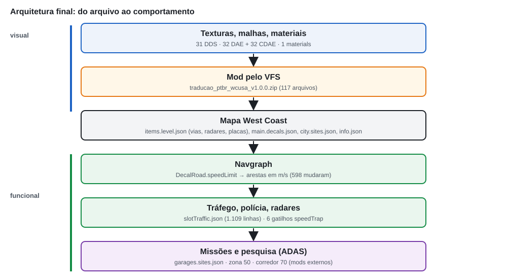

*Figura 26. Do arquivo ao comportamento. Texturas e malhas chegam ao jogo pelo VFS; os dados do nível alimentam o navgraph; o navgraph, o `slotTraffic.json` e os gatilhos dos radares alimentam IA, tráfego, polícia e fiscalização; missões e cenários de pesquisa leem as zonas e o limite da via.*

Antes de alterar qualquer dado, a fase gravou uma linha de base do validador de velocidade (13 FAIL) e escreveu um **plano** (`working/functional/phase7_plan.json`, 19 entradas). Cada entrada tem tipo, alvo em km/h e m/s, vias, zonas, radares, missões, placas, motivo e status. O gerador `tools/production/apply_phase7_functional.py` recusa qualquer decisão sem entrada no plano e confere se cada objeto do plano mudou exatamente como declarado.

### 16.2 Navgraph

No BeamNG, as vias são objetos **DecalRoad**: faixas desenhadas sobre o terreno, com um campo opcional `speedLimit` em m/s. A partir delas, o motor monta o **navgraph**, um grafo de nós e arestas usado para rotas, IA, tráfego e polícia. Cada aresta herda o limite da sua DecalRoad:
- **explícito**, se o campo `speedLimit` existe;
- **automático**, se não existe: o motor escolhe 30, 50, 60, 80, 100 ou 120 km/h conforme a geometria e a dirigibilidade.

Os **AIWaypoints** (`BeamNGWaypoint`) também têm um campo `speedLimit`, mas a Fase 7 confirmou no código do jogo (`lua/ge/map.lua`) que ele é **inerte** no 0.39.4: o motor só usa a posição e o raio do waypoint. Dois waypoints com 35 mph perto do radar 4 foram alinhados ao valor da aresta (100 km/h) só por coerência dos dados, sem efeito na IA.

Duas consequências práticas da granularidade:
- **O limite vale para a DecalRoad inteira.** Encurtar uma zona exigiria dividir o objeto, isto é, mudar a geometria do mapa, o que o projeto não faz. A zona de 50 do ADAS cobre os 1.268 m do DR312.
- **Placas mais compridas que a via não existem.** Uma placa regula a via que o seu tráfego enxerga; o levantamento precisa medir a aresta mais próxima cujo fluxo legal vê a face da placa.

Esta edição exportou o navgraph inteiro duas vezes, em 21/10/2026: com o ZIP 1.0.0 desativado e ativado (`figures/raw/navgraph_edges__off.json` e `__on.json`). O resultado confere com a Fase 3: o mapa original tem **9.337 arestas**, com a mesma distribuição registrada na primeira edição. Com o mod, são **9.338**. A aresta a mais foi investigada: é o fim da zona de 50 km/h. Como o DR312 passa a ter 50 e a ponte seguinte continua com 120, o motor mantém o nó `Bridge30_1` e divide em duas uma aresta que no original era única. Comparando as arestas pela geometria, **598 mudam de limite**.

*Tabela 7. Arestas do navgraph cujo limite muda com o mod (comparação geométrica, 21/10/2026).*

| Original (km/h) | 1.0.0 (km/h) | Arestas | Origem |
|---:|---:|---:|---|
| 40,2 | 40 | 200 | ruas residenciais com 25 mph explícito (Fase 5) |
| 43,2 / 41,4 | 40 | 59 | vias da ilha e conector com valores herdados (Fase 5) |
| 30 / 50 / 60 / 80 / 100 / 120 | 40 | 139 | vias reguladas por placa de 25 mph e faixas da praça de pedágio |
| 30 / 50 / 60 | 10 | 94 | cabines das docas e caminhos de estacionamento (Fase 5) |
| 56,3 | 60 | 83 | vias que eram 35 mph (Fase 7) |
| 56,3 | 70 | 13 | corredor do Event 01 (Fase 7) |
| 120 | 50 | 10 | zona do ADAS Speed Alert (Fase 7) |

As 96 arestas que estavam a 56,3 km/h foram todas convertidas: 83 para 60 e 13 para 70.

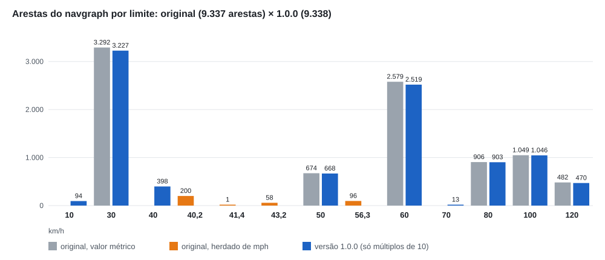

*Figura 27. Arestas do navgraph por limite, no mapa original e na 1.0.0, lidas no jogo em 21/10/2026. Os valores herdados de mph (40,2; 41,4; 43,2; 56,3) desaparecem, e surgem 10, 40, 50 e 70 explícitos.*


*Figura 28. O navgraph do West Coast na versão 1.0.0, desenhado a partir das arestas lidas no jogo (posição dos nós e limite), com norte para cima. Cor: limite em km/h. Traço grosso: aresta cujo limite mudou com o mod. Marcadores: um ponto real por classe, tirado da matriz do navgraph (`working/functional/navgraph_matrix.py`), conferido de novo com o ZIP de release. Os rótulos e a legenda foram desenhados sobre o gráfico; nenhuma imagem do jogo foi usada como fundo.*

### 16.3 Vias alteradas na Fase 7

A hierarquia aplicada pela Fase 7 foi a mesma da regra de conversão:
- estacionamentos e pátios a 10;
- vias locais a 40;
- vias que eram 35 mph a 60;
- Mount Wallis a 80 como teto regional;
- 100/120 automáticos preservados.

As exceções foram os trechos regulamentados criados para os cenários de pesquisa (Parte VII). Os IDs das vias foram reconfirmados no zip do jogo e no navgraph, e não copiados de listas antigas:
- **ex-35 mph → 60 (16,6667 m/s):** oito DecalRoads na malha urbana, na ilha e nas docas (DR571, DR666, DR625, DR989, DR1003, DR1009, DR1213, DR1216);
- **corredor do Event 01 → 70 (19,4444):** DR652, a pista norte de uma avenida dividida;
- **zona do ADAS → 50 (13,8889):** DR312;
- **saída da zona ADAS → 120 explícito:** DR758, igual ao automático. Não muda nada funcionalmente, mas a placa R-19 120 da saída passa a regular uma via com limite declarado;
- **praça de pedágio → 40 (11,1111):** as cinco faixas que atravessam as cabines.

O gerador escreve cada arquivo do nível **linha a linha** e confere o resultado contra o arquivo do jogo. Foram 132 linhas alteradas, todas declaradas: 101 da Fase 5, 7 trocas de `shapeName` da Fase 5 e 24 da Fase 7. Além delas, 15 objetos novos: o grupo `ptbr_functional_signs` e as suas 14 peças (as 7 placas R-19 novas e os seus postes). Em cada linha relida, só o campo declarado muda.

### 16.4 slotTraffic

O `slotTraffic.json` (23,5 MB) é a rede do sistema de tráfego por faixas. Ele guarda, por faixa e por ligação, um limite em m/s **derivado** das vias. O tráfego ambiente usa esse arquivo, não o navgraph: se a via fosse a 60 e o arquivo continuasse a 56,3, o tráfego andaria num limite e a IA da polícia em outro. O editor que regenera o arquivo é referenciado pelo jogo, mas não vem na versão 0.39.4.0.

A solução, criada na Fase 5 e estendida na 7, foi uma edição determinística só das linhas `"speedLimit"`, com duas regras:
- **geometria primeiro:** a faixa só é reescrita se pelo menos 90% das amostras da sua linha central ficam a até 1,6 m + meia largura do eixo de uma via alterada, e se o valor atual é o antigo efetivo daquela via;
- **classe de valor:** como todas as vias com valores vindos de mph (11,18, 11,5, 12 e 15,6464 m/s) foram convertidas, esses valores identificam a origem sem ambiguidade.

Resultado na 1.0.0: **1.109 linhas** editadas (939 da Fase 5 e 170 da Fase 7), **nenhum valor de mph restante** e JSON válido com só linhas `"speedLimit"` diferentes do arquivo do jogo. Uma checagem comparou cada faixa com o navgraph a 25%, 50% e 75% do seu comprimento: zero casos de navgraph 60 com slotTraffic 56,3.

### 16.5 Placas embutidas e praça de pedágio

O validador da Fase 4 só olhava os objetos `sign_speed*.dae`. A Fase 7 descobriu que o `roadsigns.dae`, um único objeto estático com toda a sinalização montada do mapa, contém mais **47 placas de velocidade**:
- **23 regulamentares** "SPEED LIMIT nn": 30 (4), 40 (10), 45 (1), 50 (3) e 70 (5) mph;
- **24 de advertência**, amarelas, sob placas de curva: 15 (9), 20 (5), 25 (7) e 30 (3) MPH.

Todas as células envolvidas (placa branca, SPEED LIMIT, MPH, algarismos) são compartilhadas com escudos de rodovia, saídas e pedágio. A regra de valor foi a mesma dos radares:
- **regulamentar → R-19 com o limite da via que a placa regula**, medido no jogo. Nenhuma via muda por causa dessas placas. O resultado foram 40 (×2), 60 (×5), 80 (×3), 100 (×8) e 120 (×5);
- **advertência → tabela de conversão** (15 → 20, 20 → 30, 25 → 40, 30 → 50 km/h), sem efeito funcional.

A execução foi feita sem tocar nenhuma célula compartilhada. Faces novas foram desenhadas em espaço livre do atlas: opacidade original abaixo de 8 e nenhuma UV de malha do jogo. Os 189 quadriláteros dessas placas foram re-apontados, cada um casado exatamente uma vez pela posição.

A cabine de pedágio tinha DO NOT STOP / SPEED LIMIT 25. A placa de baixo é um conjunto 2 × 2 de quadriláteros com UV sobreposta. Por isso a face nova foi "assada": desenhada em metros e recortada para cada quadrilátero. A cabine virou NÃO PARE / R-19 40, e as cinco faixas que atravessam as cabines passaram a 40 explícito.


*Figura 29. (A–B) Placa de malha própria no ponto `r19_40_hill`: STOP + SPEED LIMIT 25 → PARE + R-19 40, mesma câmera, ZIP desativado e ativo (21/10/2026). (C–D) Placa embutida no `roadsigns.dae` numa rodovia: SPEED LIMIT 70 → R-19 120, o limite da via. (E–F) Advertência de curva: 20 MPH → 30 km/h. (C–F) são do QA da Fase 7, que fotografou as 47 placas com o mod ligado e desligado.*


*Figura 30. Cabine da praça de pedágio, QA da Fase 7. (A) DO NOT STOP / SPEED LIMIT 25. (B) NÃO PARE / R-19 40, com as faixas a 40 km/h no navgraph e a IA medida a no máximo 40,05 km/h.*

Duas placas urbanas mostram 100 km/h, uma em Chinatown e outra no trevo junction1. O motor dá 100 a vias de duas faixas de mão única, inclusive na cidade, e a placa diz a verdade sobre o que a IA faz. Reduzir essas vias a 50 seria uma decisão de limite urbano fora do escopo da fase, e ficou registrada como limitação.

### 16.6 Radares

Os radares do West Coast são gatilhos (`BeamNGTrigger`) do tipo `speed`, com `speedLimit` em m/s. O código do jogo (`lua/ge/extensions/gameplay/speedTraps.lua`) dispara quando a velocidade passa de `speedLimit + speedLimitTolerance`. Como nenhum gatilho do mapa define a tolerância, vale o padrão de 10% do limite. Os seis radares estavam a 15,6464 m/s (35 mph). Um deles, o radar 4, ficava numa aresta de 100 km/h.

A regra da Fase 4 foi aplicada sem mudança: **placa = via = radar**. O radar fiscaliza o limite da via onde está. O sentido fiscalizado foi medido no jogo: o produto escalar entre o eixo do gatilho e o fluxo legal da aresta foi 1,0 nos seis.

*Tabela 8. Radares na versão 1.0.0 (`working/functional/radar_changes.json`).*

| Radar | Via fiscalizada | Antes | 1.0.0 | Dispara acima de |
|---|---|---:|---:|---:|
| 2 | DR652, corredor do Event 01 | 56,3 | 70 | 77 |
| 3 | DR571, urbana | 56,3 | 60 | 66 |
| 4 | trevo junction1 (automático) | 56,3 | **100** | 110 |
| 5 | DR989, ilha | 56,3 | 60 | 66 |
| 6 | DR1213, portaria das docas | 56,3 | 60 | 66 |
| 7 | DR1009, ilha | 56,3 | 60 | 66 |

O radar 4 era o caso fora do padrão. Não havia zona de 60, placa de 60 nem transição regulamentada no sentido que ele fiscaliza; os únicos dados de 35 mph eram os campos inertes dos waypoints. A decisão foi **radar = 100**, sem reduzir a via. A tolerância de 10% foi preservada: a localização troca o limite, não a regra de fiscalização. O valor `11.176` (25 mph em m/s) que aparece em `speedTraps.lua` está só num bloco de comentário de exemplo e não é usado pelo código.

O teste no jogo usou a lógica do próprio radar. O carro de teste recebe uma largada lançada antes do gatilho e passa por ele em velocidade constante, conduzido pela IA. O script registra o evento `onSpeedTrapTriggered` emitido pelo jogo. A Figura 31 reúne as 18 passagens da Fase 7 e as 7 do teste do ZIP de release.

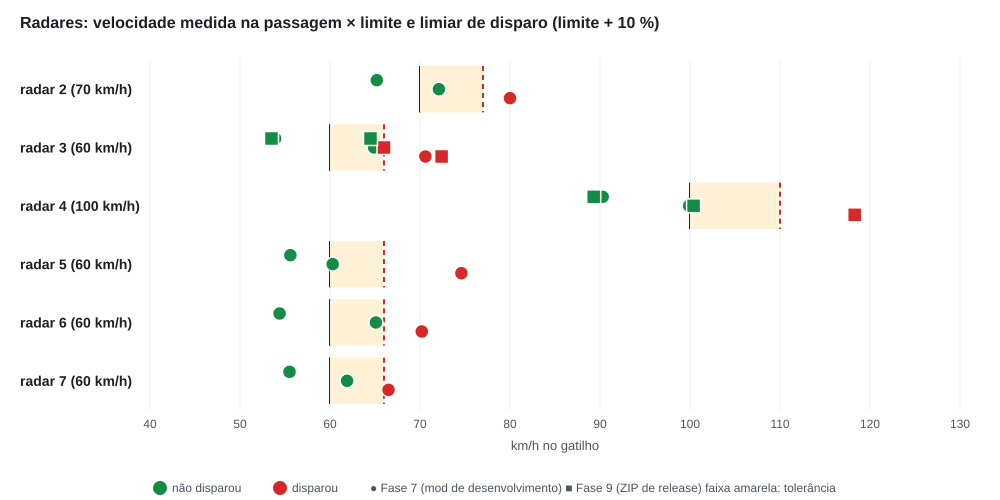

*Figura 31. Velocidade medida no gatilho de cada radar. Linha preta: limite. Faixa amarela: tolerância de 10%. Linha vermelha tracejada: limiar de disparo. Verde: não disparou. Vermelho: disparou. Círculos: Fase 7 (mod de desenvolvimento, `tests/reports/phase7/radar_test.json`). Quadrados: Fase 9 (ZIP de release, `tests/reports/release/release_smoke.json`). Todas as 25 passagens terminaram como a regra do jogo prevê. O quadrado vermelho do radar 3 junto do limiar é uma passagem com alvo de 65 km/h em que o carro chegou a 66,1 km/h (registro do jogo), acima dos 66,0 do limiar.*

### 16.7 Zonas e missões

O mapa e as missões guardam limites em zonas poligonais. Uma busca no código do jogo 0.39.4 não encontrou **nenhum consumidor** do `speedLimit` dessas zonas: o fluxo da missão garageToGarage usa as zonas para sortear origem e destino, não a velocidade. Os valores são dado. Mesmo assim, foram mantidos coerentes com a hierarquia em km/h:

| Arquivo | Zona | Antes (m/s) | 1.0.0 |
|---|---|---:|---:|
| `city.sites.json` (nível) | horizon_estates | 13,40 (30 mph) | 13,8889 (50) |
| | the_dockyards | 15,60 (35 mph) | 16,6667 (60) |
| | mount_wallis | 22,40 (50 mph) | 22,2222 (80) |
| `garages.sites.json` (missões) | downtownBelasco, residential | 13,40 | 13,8889 (50) |
| | dockyard | 15,60 | 16,6667 (60) |
| | mountWallis | 22,40 | 22,2222 (80) |

O arquivo das garagens fica fora do nível, em `gameplay/`, e o override foi posto no mesmo caminho dentro do mod. A missão garageToGarage das Docas foi iniciada no jogo: sorteou um trabalho a partir da zona Docas e criou o veículo.

As seis missões `arrive` têm um campo de velocidade máxima, mas com `maxSpeedActive = false`. Funcionalidade inativa não foi alterada; o validador as marca como SKIP.

---

# Parte VII — Cenários de pesquisa (ADAS)

## 17. Integração com cenários experimentais

### 17.1 Contexto

A máquina do projeto tem mods de pesquisa independentes, que usam o West Coast como cenário para estudos com **ADAS** (*Advanced Driver Assistance Systems*, sistemas de assistência ao motorista). Três deles dependem de velocidade:
- **ADAS Speed Alert** (versões local e web): alerta quando o carro passa de 50 km/h;
- **Event 01:** reconhecimento de limite, com alerta a 70 km/h e rearme a 65 km/h;
- **Reaction Test:** instrui o participante a dirigir entre 40 e 70 km/h.

Esses mods **não fazem parte** do pacote de localização e não são alterados por ele. A questão para a localização era outra: os limiares desses cenários estão em km/h e eles **não leem o mapa**. Na linha de base da Fase 7, o validador acusava três divergências entre o limiar e a via onde cada cenário começa. A regra da Fase 4 foi: o ADAS de alerta de limite acompanha o limite **regulamentado** do cenário. Portanto, os limiares não mudam; quem muda é o cenário viário.

### 17.2 Speed Alert: 50 km/h numa via de 120

O problema original:

```text
alerta ADAS = 50 km/h
via no início do cenário = 120 km/h (automático, via expressa)
```

O participante começaria numa via de 120 com uma regra de 50 que nenhuma placa mostra. A solução foi transformar a via sob o início do cenário num trecho regulamentado de 50:
- o **DR312 inteiro** (1.268 m) passou a 13,8889 m/s, porque o limite é por DecalRoad;
- **R-19 50** nos dois lados da entrada, 25 m depois do início da zona;
- outra **R-19 50** no canteiro central, visível da posição inicial, e uma repetição à direita a 200 m;
- **R-19 120** na saída, 25 m depois da transição, na mesma pista.

As placas são objetos novos, montados como uma placa original do mapa: mesma altura e o mesmo poste. Ficam no grupo `ptbr_functional_signs`, e as posições foram medidas no jogo e fixadas em `working/functional/adas_zones.json`. `SpeedLimitKmh = 50` não foi alterado.

O QA da Fase 7 testou as duas versões do cenário (local e web): navgraph a 50 no início, sem alerta a 40 km/h, alerta a 53,9 e 54,5 km/h, desligamento a 42,3 e 42,7 km/h ao reduzir, e todas as amostras dentro da zona com limite 50. No teste do ZIP de release (Fase 9), o cenário local foi repetido com o mesmo resultado.

### 17.3 Event 01: um corredor de 70 km/h

O Event 01 começava num semáforo no fim do DR272, uma via local que a Fase 5 havia posto a 40 km/h. O validador acusava "70 ≠ 40 no início". Trocar 70 por 40 no cenário estava proibido: o limiar é parte do desenho experimental. O próprio autor do cenário já tinha esboçado uma zona de 70 ao longo da avenida, num arquivo arquivado do mod.

A decisão foi:
- **corredor de 70:** o DR652 inteiro, a pista norte de 216 m de uma avenida dividida. Sem o corredor, a avenida iria a 60, como as outras vias que eram 35 mph;
- **radar 2:** está no corredor, e foi a 70;
- **R-19 70** na entrada do corredor e repetida depois dos cruzamentos laterais;
- **início movido 45 m à frente,** para dentro do corredor, porque a rota original não comportava 70 no ponto de partida.

Essa última mudança está **no mod de pesquisa**, não no pacote de localização. Foi aplicada por um modo separado do gerador (`--scenarios`), que confere o texto antigo antes de trocar e guarda o original na pasta `_archive/` do próprio mod.

*Tabela 9. QA do Event 01 (Fase 7, `tests/reports/phase7/adas_qa.md`).*

| Situação | Resultado |
|---|---|
| navgraph no novo início | 70 km/h |
| 65 e depois 69 km/h | nenhum alerta (máx. 68,4) |
| ≥ 70 | alerta nº 1 a 70,8 km/h, dentro do corredor |
| acima de 70 mantido | nenhum alerta novo |
| redução abaixo do rearme | rearme a 64,8 km/h |
| acima de 70 de novo | alerta nº 2 a 70,0 km/h |

O alerta do Event 01 depende só da velocidade, não da posição. No teste, o segundo alerta aconteceu depois do fim do corredor, numa alça de 60 km/h. É o comportamento original do cenário, registrado como observação.


*Figura 32. (A) Visão do participante no início do ADAS Speed Alert, na zona de 50 (QA da Fase 7). (B) R-19 50 no início da zona, capturada com o ZIP de release (21/10/2026). (C–D) Entrada do corredor do Event 01 com o mod desligado e ligado (QA da Fase 7): a R-19 70 só existe com o mod. As capturas do Speed Alert feitas no teste de release mostram o menu principal do jogo sobre a cena e não foram usadas; o resultado funcional daquele teste veio dos contadores do controlador do cenário.*

### 17.4 Reaction Test: faixa experimental, não limite

O Reaction Test instrui o participante a dirigir entre 40 e 70 km/h enquanto um veículo faz uma fechada. Essa faixa é uma **instrução experimental**, não um limite regulamentar. A decisão metodológica da Fase 4 foi mantê-la independente:
- sem zona própria;
- sem mudar o navgraph por causa dela;
- sem placa.

O validador a marca como SKIP por política, não por omissão.

O efeito colateral foi documentado. O Reaction Test usa o mesmo início do Speed Alert, então o seu tráfego ambiente passou a andar a cerca de 50 km/h na zona, e o participante vê R-19 50 enquanto a instrução fala em 40–70. O veículo da fechada usa velocidade fixa e não muda. O teste rápido no jogo passou pelas fases armado → evento → fim sem erro. A avaliação do efeito ficou com o pesquisador responsável.

### 17.5 Por que os trechos de pesquisa estão no pacote

Na Fase 9, o responsável decidiu manter a zona de 50 e o corredor de 70 no pacote público. Os motivos:
- a 1.0.0 fica igual à versão aprovada pelos testadores na Fase 8;
- cada trecho é coerente por si: placa, via e radar dizem a mesma coisa;
- nenhum depende de mod externo;
- separá-los num pacote opcional mudaria velocidades já aprovadas e criaria dois mods sobrescrevendo os mesmos arquivos do nível, com precedência pouco previsível.

A consequência está em `KNOWN_ISSUES.md`: quem dirige pela via expressa fora dos cenários encontra uma redução sinalizada para 50 numa via de 120.

---

# Parte VIII — Validação

## 18. Validação automática e QA no jogo

### 18.1 O validador

O validador (`tools/validation/validate.py`, criado na Fase 4 e ampliado até a Fase 9) impede que os erros das traduções antigas voltem. Ele não julga se uma tradução está bonita; verifica se ela está **tecnicamente íntegra** e **funcionalmente coerente**. Nenhum comando altera texturas, o mod, o jogo ou os originais. Cada verificação devolve PASS, WARN, FAIL ou SKIP, e o processo termina com código 0, 1 ou 2.

*Tabela 10. Suítes do validador na versão 1.0.0.*

| Comando | O que verifica | 1.0.0 |
|---|---|---|
| `selftest` | os originais comparados consigo mesmos e o DDS do PoC: o validador não reprova o que está certo | PASS 121 |
| `regression` | todas as traduções antigas com defeito conhecido são reprovadas pelo motivo esperado; a cópia idêntica do `t_sealbrik_logo` passa (controle negativo) | 10/10 |
| `mod` | nomes e caminhos virtuais, arquivos proibidos, `mod_info`, famílias, texturas (regiões, alfa) e DDS (formato, sRGB, mipmaps, tamanho) | PASS 273 |
| `mod --installed` | o mesmo, mais a cópia instalada idêntica ao repositório | PASS 274 |
| `new` | assets sem original (R-19), materiais, malhas com estrutura idêntica à original, `.cdae` mais novo que o `.dae`, overrides de nível que só mudam o que foi declarado | PASS 108 |
| `speeds --refresh` | lê o navgraph no jogo; limites em múltiplos de 10; placa = via; radar = via; zonas; ADAS = via no início do cenário; placas embutidas e pedágio | 27 PASS · 1 WARN · 0 FAIL · 7 SKIP |
| `unittest` | 63 testes com dados sintéticos (validador, geradores das Fases 5 e 7, empacotamento) | 63 OK |

Os SKIPs e o WARN de `speeds` são legítimos e explicados no relatório:
- 1 SKIP é o Reaction Test (faixa experimental, por política);
- 6 SKIPs são as missões `arrive` inativas;
- o WARN é informativo: quatro placas nas transições das docas regulam a via **seguinte**, e a associação declarada placa → via passa.

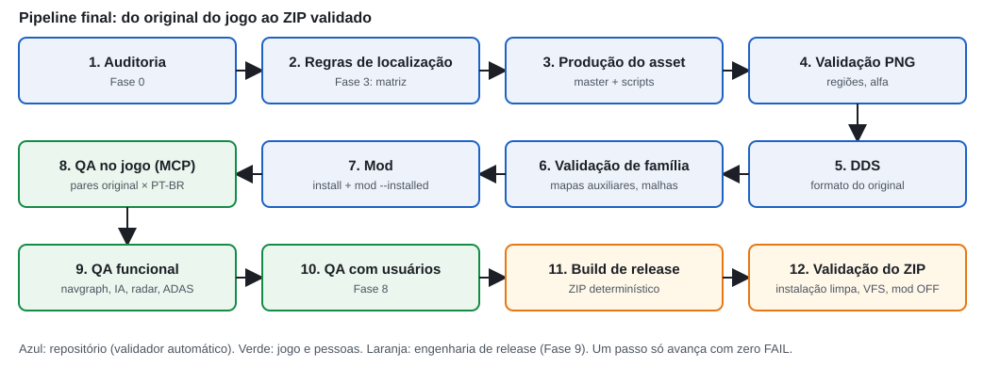

*Figura 33. Pipeline completo da versão 1.0.0, do original do jogo ao ZIP validado. Cada passo só avança com zero FAIL.*

### 18.2 A progressão dos números

O validador de velocidade é a melhor medida do caminho percorrido.
- **Primeira linha de base (Fase 4):** 17 FAIL, todos inconsistências reais do mapa original. Eram 85 limites explícitos fora de múltiplo de 10, zonas e missões em 48,2, 56,2 e 80,6 km/h, radares a 56,3 km/h (um deles numa via de 100), placas divergentes da via e ADAS com limiar diferente da via no início. Uma suíte que desse "tudo verde" no mapa original estaria cega.
- **Fase 5:** 13 FAIL. Os quatro eliminados eram das placas de 5 e 25 mph; os 13 restantes eram de sistemas fora do escopo da fase (60 km/h, zonas, radares, ADAS).
- **Fase 6:** 13 FAIL, idênticos. A fase era só visual e não podia mexer em velocidade.
- **Fase 7:** 0 FAIL.

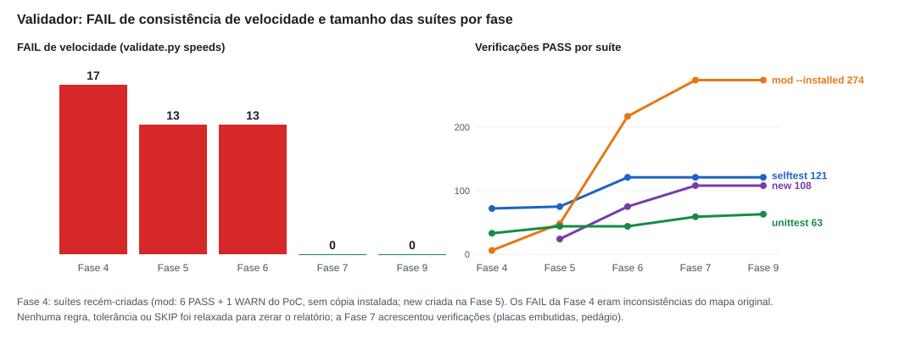

*Figura 34. À esquerda, FAIL de consistência de velocidade por fase. À direita, verificações aprovadas por suíte: as suítes cresceram com o escopo (o `mod --installed` passa de 48 para 274 verificações à medida que as famílias entram no mod).*

O zero da Fase 7 não veio de afrouxar o teste. Nenhuma regra, tolerância ou SKIP foi relaxada; ao contrário, a fase **acrescentou** verificações (as 47 placas embutidas e a praça de pedágio). O validador também foi corrigido ao longo do caminho, sempre na direção de ficar mais rígido:
- a tolerância de múltiplo de 10 caiu de 0,3 para 0,05 km/h, porque os 11,18 m/s herdados passavam como "40";
- a contagem de placas de 5 mph passou a ignorar decalques de malha;
- as zonas passaram a ser lidas com a precedência do VFS (arquivo do mod antes do arquivo do jogo).

### 18.3 QA visual no jogo

O BeamNG 0.39 inclui um servidor **MCP** (*Model Context Protocol*): um protocolo JSON-RPC sobre HTTP que expõe ferramentas que um cliente externo pode chamar. O servidor do jogo lista 86 ferramentas. O projeto usou um cliente Python mínimo e um *runner* de QA que fazem:
- carga de mapa;
- câmera livre com pose exata;
- horário, sol, vento e nuvens fixos;
- captura de tela;
- origem de arquivo no VFS (`file_info`);
- log do jogo;
- Lua do motor, para o que não tem ferramenta dedicada (ativar e desativar mods, consultar o navgraph, mover a IA).

Cada ponto de QA é um registro de catálogo (`tests/qa_locations.json`) com a forma e a posição do objeto, a pose da câmera e os elementos esperados. Na Fase 2, a reprodutibilidade foi medida: restaurar uma pose deu deslocamento de 0 px, e a diferença média entre duas capturas ficou perto do piso de ruído depois de fixar o vento e remover as nuvens.

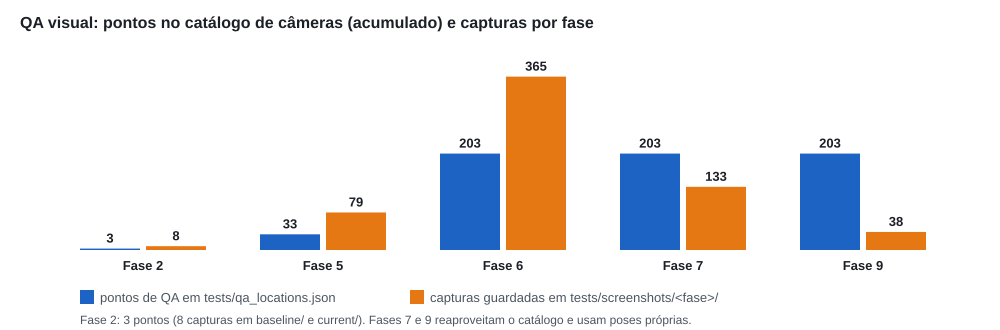

*Figura 35. Pontos no catálogo de câmeras (acumulado) e capturas guardadas por fase. A Fase 6 acrescentou 170 pontos (84 de textura e 86 de letreiros de glifos). As Fases 7 e 9 usaram o catálogo e poses próprias (placas novas, radares, ADAS, teste de release).*

Em números: o catálogo passou de 3 pontos de teste na Fase 2 para 33 na Fase 5 e **203** na Fase 6. As capturas guardadas somam 627 em `tests/screenshots/`: 79 da Fase 5, 365 da Fase 6 (22 delas à noite), 133 da Fase 7 e 38 do teste de release, mais as capturas das Fases 1 e 2. Cada par original × PT-BR usa a mesma câmera, e cada troca de estado segue o protocolo da Figura 9. A **revisão humana** em folhas de contato continuou indispensável: ela registrou a tipografia substituta (Bahnschrift, Arial, Impact e Georgia no lugar das fontes originais), palavras muito condensadas e o brilho um pouco menor dos néons novos.

### 18.4 IA e tráfego

A IA do jogo, no modo `legal` (que respeita o limite do navgraph), foi posta para dirigir vias de cada classe. O critério: a velocidade máxima não pode passar de 3% + 1 km/h acima do limite, e a IA precisa chegar a pelo menos 80% dele.

*Tabela 11. Teste da IA na Fase 7 (`tests/reports/phase7/ai_qa.md`).*

| Via | Limite | Máx. | p90 | Resultado |
|---|---:|---:|---:|---|
| DR312, zona ADAS | 50 | 50,78 | 50,67 | PASS |
| DR272, via local | 40 | 40,65 | 40,22 | PASS |
| DR1009, ilha | 60 | 60,42 | 60,01 | PASS |
| DR989, ilha | 60 | 61,42 | 59,82 | PASS |
| DR652, corredor do Event 01 | 70 | 67,23 | 66,97 | PASS |
| DR282, via de mão dupla | 80 | 67,16 | 61,40 | PASS |
| praça de pedágio | 40 | 40,05 | 39,74 | PASS |

Nas vias de 70 e 80, a IA ficou abaixo do limite pela curvatura e pelo comprimento do trecho, o que o critério aceita. Na Fase 5, a IA tinha sido medida a no máximo 40,4 km/h numa via de 40 e a 6,8 km/h numa faixa de 10.

### 18.5 Radares e ADAS

Os testes dos radares estão na Figura 31 e os dos cenários de pesquisa, na seção 17. Um detalhe do método merece registro. Num nível carregado pelo MCP, fora do modo livre do jogo, a extensão de radares não está ativa. O teste a carrega explicitamente, o que produz um erro inofensivo do modo livre ao registrar o recorde de velocidade, uma vez por disparo. Esse erro aparece só nos logs dos testes e não em jogo normal.

---

# Parte IX — QA global e usuários

## 19. Fase 8: QA global e testes externos

A Fase 8 foi conduzida **fora do repositório**. O responsável do projeto aplicou testes com usuários externos sobre a versão 0.7.0 (commit `1973cdb`, idêntico ao publicado) e comunicou o aceite em 21/10/2026, ao abrir a Fase 9. O registro formal está em `docs/production/PHASE8_GLOBAL_QA.md`, e foi escrito com uma regra explícita: **registrar só o que pode ser comprovado**.

O que o registro sustenta:
- houve testes com usuários externos;
- a versão testada foi a 0.7.0, cuja árvore do mod é idêntica à 1.0.0, salvo o arquivo de metadados;
- não foram reportados problemas bloqueadores para o escopo da versão.

O que ele **não** sustenta, e por isso este artigo não afirma:
- o número de testadores;
- o perfil, a idade ou a experiência deles;
- a data dos testes;
- a versão do jogo de cada um;
- qualquer resultado quantitativo.

Os testadores aparecem nos créditos como "testadores voluntários da fase de QA", por decisão do responsável.

As duas formas de validação respondem a perguntas diferentes. A **validação automatizada** responde se o asset está íntegro e se a placa, a via e o radar concordam; ela é exaustiva, repetível e cega para o que não foi modelado. A **avaliação por usuários** responde se a experiência faz sentido para quem dirige: se as palavras soam naturais, se alguma placa confunde, se falta algo que a matriz não previu. Nenhuma substitui a outra. O projeto chegou à Fase 8 com a primeira esgotada (0 FAIL, 203 pontos de QA) e usou a segunda como critério de aceite.

O veredito registrado foi **"FASE 8 APROVADA — QA global e testes externos concluídos."** A formulação adotada para o resultado é a que o registro permite: a versão candidata passou pela campanha de QA prevista e por testes externos, sem problemas bloqueadores reportados para o escopo da versão 1.0.0.

---

# Parte X — Release

## 20. Fase 9: engenharia da release

### 20.1 Objetivo e regra

A Fase 9 transformou o projeto validado numa distribuição reproduzível. A regra da fase foi explícita: **não é uma fase de desenvolvimento**. Nada de retraduzir placas, mexer em velocidades ou acrescentar recursos; só bug bloqueador poderia ser corrigido, e nenhum apareceu. A única mudança no conteúdo do mod foi o metadado de versão (`info.json`: 0.7.0 → 1.0.0).

### 20.2 Repositório e runtime

O repositório guarda o projeto inteiro: auditoria, regras, masters, ferramentas, validadores, relatórios, mais de 600 capturas e o artigo técnico. Nada disso foi apagado para "limpar" o repositório, porque ele é também o registro da pesquisa. O **pacote**, ao contrário, contém só o que o jogo carrega.

A auditoria de escopo (`docs/release/SCOPE_AUDIT.md`) classificou cada um dos 117 arquivos de `mod/traducao_ptbr_wcusa/`: 116 são necessários em tempo de execução e 1 é metadado. Nenhum é temporário, de desenvolvimento ou documentação.

Os mods de pesquisa foram auditados à parte. Nenhum arquivo deles está no pacote, e nenhum dos 116 caminhos de runtime aparece em outro mod instalado.

Uma descoberta da fase: o jogo só lê o `mod_info/<id>/info.json` quando `<id>` não tem sublinhado. Esse é o mecanismo dos mods do repositório oficial, que envia o identificador na checagem de atualizações. Fazer o jogo ler o arquivo daria ao pacote uma identidade falsa de mod do repositório. O arquivo ficou como metadado do projeto, e o gerenciador de mods mostra o pacote pelo nome do ZIP.

### 20.3 Build reprodutível

O ZIP não é montado à mão. O script `tools/release/build_release.py` executa, em ordem, e falha em qualquer etapa:
1. **Git:** árvore limpa (o build de release recusa mudanças não commitadas).
2. **Árvore do mod:** validação sem FAIL.
3. **Overrides gerados:** os dados do nível (que não ficam no Git, por serem cópias de arquivos do jogo) conferidos contra as decisões versionadas (132/132 linhas, 15/15 objetos).
4. **Seleção:** só `.dds`, `.dae`, `.cdae` e `.json`; nomes proibidos (PSD, XCF, backups, `_ptbr`, `_poc`, caches, logs, `.git`, `.env`, `__pycache__`, `Thumbs.db`) reprovam o build.
5. **Originais desnecessários:** cada arquivo comparado por SHA-256 com o arquivo do jogo no mesmo caminho virtual. Resultado: 100 substituem um arquivo do jogo, todos modificados; 16 são novos; **0 cópias idênticas**.
6. **Varredura de texto:** nenhum caminho absoluto, nome de usuário, e-mail, token ou credencial nos 54 arquivos de texto.
7. **Staging e ZIP determinístico:** entradas ordenadas, datas fixas, permissões fixas e cada `.cdae` 2 minutos depois do seu `.dae`.
8. **SHA-256 e manifesto** com caminho, tamanho e hash de cada arquivo.
9. **Extração** numa pasta nova e conferência contra o staging e a árvore do mod: mesmos 117 arquivos, mesmos hashes, nada a mais.

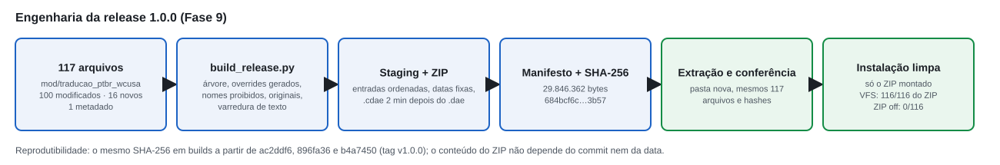

*Figura 36. Do mod ao pacote validado, com os números reais do build e do teste de instalação limpa.*

O conteúdo do ZIP não depende do commit nem da hora do build. Três builds, a partir de `ac2ddf6` e duas vezes de `896fa36`, deram o mesmo SHA-256. Depois dos commits finais, um quarto build a partir de `b4a7450`, o commit marcado pela tag `v1.0.0`, também. Durante a fase, o próprio script teve um defeito: o segundo build recusava rodar porque os registros do primeiro, ainda não commitados, deixavam a árvore "suja". O defeito foi corrigido no commit `896fa36`.

*Tabela 12. Números do pacote final (`docs/release/BUILD_1.0.0.md`, `release/output/traducao_ptbr_wcusa_v1.0.0_manifest.txt`).*

| Campo | Valor |
|---|---|
| Versão | 1.0.0 |
| Tag | `v1.0.0` → `b4a7450` |
| Commit do conteúdo validado no jogo | `896fa36` (mesma árvore do mod) |
| Arquivos de runtime | 116 (31 DDS · 32 DAE · 32 CDAE · 1 materials · 20 JSON de nível/gameplay) |
| Metadados | 1 (`mod_info/traducao_ptbr_wcusa/info.json`) |
| Overrides de arquivos do jogo | 100 (todos modificados) |
| Arquivos novos | 16 (família R-19 e grupo `ptbr_functional_signs`) |
| Tamanho do ZIP | 29.846.362 bytes (conteúdo: 98.973.556 bytes) |
| SHA-256 | `684bcf6c2e93c9397fa1acc667dd37792d2e55b05973c32bc1a1bd33396e3b57` |
| BeamNG.drive | 0.39.4.0 |

### 20.4 O teste do ZIP real

Todo o QA anterior usou a cópia de desenvolvimento, uma pasta em `mods/unpacked/`. Isso não prova que o **pacote** funciona. Um arquivo esquecido no build, uma data errada num `.cdae` ou um caminho com maiúscula diferente passariam despercebidos. Por isso a Fase 9 testou o ZIP real numa instalação limpa:
1. a cópia de desenvolvimento foi desativada no gerenciador de mods, o jogo foi fechado e a pasta foi **retirada** de `mods/`, guardada fora da pasta do jogo e devolvida no fim;
2. só o ZIP foi copiado para `mods/`, com o SHA-256 da cópia conferido;
3. ao abrir, o jogo registrou o ZIP **ativo por padrão** e a cópia de desenvolvimento como "mod vanished";
4. o West Coast foi carregado passando pelo `smallgrid`.

Deixar as duas cópias ativas invalidaria a prova. As duas declaram os mesmos caminhos virtuais, e não haveria como saber de qual delas o jogo leu cada arquivo. Um arquivo faltando no ZIP seria entregue silenciosamente pela cópia de desenvolvimento.

### 20.5 VFS da release

Para cada um dos 116 arquivos de runtime do manifesto, o teste perguntou ao jogo a origem real (`FS:getFileRealPath`). Resultado: **116 de 116 vêm de `mods\traducao_ptbr_wcusa_v1.0.0.zip`**. Depois de carregar o mapa, o cache do usuário não tinha nenhum `.cdae` do pacote. Com o ZIP ativo:
- o smoke visual passou por PARE, R-2, R-19 10/40/50/70/120, as quatro marcações do pavimento, posto, outdoor, néon, indústria, transporte, estúdio, refinaria, siderúrgica e letreiro de glifos, de dia e de noite;
- o smoke funcional leu 19 de 19 pontos do navgraph corretos (de 10 a 120 km/h), os seis radares com os valores certos, o grupo de placas novas e o combustível em litro;
- os logs filtrados não tiveram nenhuma linha que citasse o mod, seus caminhos, `roadsigns`, `r19` ou `west_coast_usa`. As categorias de erro eram as mesmas com o ZIP ativo e desativado, vindas de um mod de veículo instalado e do próprio jogo.

### 20.6 Mod OFF

O teste final desativou o ZIP e recarregou o mapa passando por outro mapa:
- **VFS:** 0 de 116 arquivos vieram do ZIP. Os modificados voltaram aos zips do jogo, e os novos deixaram de existir.
- **Visual:** STOP, YIELD, SPEED LIMIT 25 e 5, STOP no pavimento, "NEW TURBO MENU 4.99-".
- **Funcional:** vias de volta a 56,3 e 120 km/h, radares a 35 mph, grupo de placas ausente, `gallonUS` de volta.
- **Cache:** nenhum `.cdae` do pacote no cache.


*Figura 37. O mesmo lugar com o ZIP 1.0.0 desativado (linha de cima) e ativo (linha de baixo), capturado em 21/10/2026 para esta edição: cruzamento de Chinatown, placa da colina e KEEP CLEAR visto de cima. A desativação devolve o mapa original sem resíduo.*

As capturas desta edição repetiram o procedimento em 21/10/2026: só o ZIP instalado, estados ativo e desativado, troca de mapa entre eles e o ambiente de desenvolvimento restaurado no fim (`mod --installed`: cópia idêntica ao repositório).

### 20.7 Versão, documentação e congelamento

A Fase 9 produziu a documentação de usuário e de release:
- `README.md` para o usuário final;
- `docs/INSTALLATION.md`, que descreve o método padrão do BeamNG: copiar o ZIP, sem descompactar, para a pasta `mods` do usuário;
- `CHANGELOG.md`;
- `docs/release/RELEASE_NOTES_1.0.0.md`;
- `docs/release/KNOWN_ISSUES.md`;
- `docs/CREDITS.md`, com uma seção de direitos que não reivindica nada sobre os assets do jogo e não escolhe uma licença;
- `CONTRIBUTING.md`, que adota versionamento semântico daqui em diante;
- `docs/release/FINAL_PROJECT_STATUS.md`.

A versão 1.0.0 está congelada: o ZIP com esse número não será substituído por conteúdo diferente, e qualquer correção vira 1.0.1 ou 1.1.0.

---

# Parte XI — Resultados e discussão

## 21. Resultados

### 21.1 Métricas finais

*Tabela 13. Principais números da versão 1.0.0. A fonte de cada um está em `DATA_SUMMARY_FINAL.md`.*

| Métrica | Valor |
|---|---|
| Texturas originais no manifesto inicial | 35 |
| DDS no pacote | 31 (17 BC7 sRGB, 1 BC7 linear, 9 BC4, 4 BC5) |
| Malhas no pacote | 32 `.dae` + 32 `.cdae` (25 com letreiros de glifos, sendo um deles o `roadsigns.dae`, que também tem as placas embutidas; 4 R-19; `sign_speed25`; 2 cabines de pedágio) |
| Arquivos de runtime / metadado | 116 / 1 |
| Overrides / novos / cópias idênticas | 100 / 16 / 0 |
| Valores de R-19 com textura própria | 5 (10, 40, 50, 70, 120) |
| Placas de velocidade convertidas no mapa | 18 de malha própria (11 R-19 40 + 7 R-19 10) + 47 embutidas + cabines + 7 placas novas |
| Linhas da matriz | 323 (217 com uso confirmado ou provável no West Coast, todas tratadas) |
| Arestas do navgraph alteradas | 598 de 9.337 (6,4%) |
| Linhas de dados de nível alteradas | 132 + 15 objetos novos |
| Linhas do `slotTraffic.json` alteradas | 1.109 |
| Radares ajustados | 6 |
| Zonas convertidas | 3 do mapa + 4 de missão |
| FAIL de velocidade | 17 (original) → 0 |
| Pontos de QA no catálogo | 203 |
| Capturas de QA guardadas | 627 |
| Testes unitários | 63 |
| Tamanho do ZIP | 29.846.362 bytes |

### 21.2 Evolução

*Tabela 14. Estado do projeto em cada marco.*

| Momento | Estado |
|---|---|
| Início (30/09) | 11 traduções experimentais com imagem regenerada; nenhum mod, teste ou versionamento |
| Fase 1 | *override* comprovado pelo VFS: ON → PARE, OFF → STOP |
| Fase 2 | QA automatizado no jogo, com câmera e ambiente reproduzíveis |
| Fase 3 | regras de localização com fonte normativa; matriz de 308 entradas |
| Fase 4 | validação automática; 17 FAIL do mapa original documentados |
| Fase 5 | primeira família definitiva; R-19 10/40; 101 vias |
| Fase 6 | produção visual de todas as famílias usadas; 25 letreiros de glifos |
| Fase 7 | integração funcional: 0 FAIL de velocidade |
| Fase 8 | QA global e testes externos aprovados |
| Fase 9 | release 1.0.0 reproduzível, testada como instalação limpa |

### 21.3 Antes e depois

As figuras desta edição que comparam original e 1.0.0 com a mesma câmera são a principal evidência visual do resultado:
- PARE (Figuras 1 e 8);
- R-2 (Figura 13);
- marcações no pavimento (Figura 18);
- posto (Figura 19);
- outdoor (Figura 20);
- indústria (Figura 21);
- transporte (Figura 22);
- comércio (Figura 23);
- letreiros de glifos (Figuras 24 e 25);
- placas de velocidade (Figuras 29 e 30);
- reversibilidade (Figura 37).

A Figura 38 mostra o resultado de dia e de noite no mesmo ponto da abertura.


*Figura 38. O cruzamento da Figura 1 na versão 1.0.0, de dia e de noite (preset noturno: sol a −20°, céu limpo), só com o ZIP de release (21/10/2026). A placa e a legenda do pavimento continuam legíveis sob a iluminação pública.*

## 22. Discussão

### 22.1 A complexidade escondida da localização

Num programa comum, localizar costuma ser trocar *strings*. Num ambiente 3D, o caso do West Coast mostrou que cada palavra visível está presa a uma cadeia técnica:
- uma região de um atlas;
- coordenadas UV numa malha;
- um formato de compressão;
- um canal alfa comparado a um limiar;
- mapas auxiliares que definem o contorno e o relevo das letras;
- às vezes, quadriláteros da própria geometria.

A localização exigiu, ao mesmo tempo, arte, modelagem, materiais, programação, dados de mapa, leitura de normas e QA. As traduções antigas acertaram boa parte do vocabulário e erraram quase toda a engenharia. Não por descuido com a língua, mas porque trataram texturas como figuras.

### 22.2 Localização funcional

Este artigo chama de **localização funcional** a adaptação que mantém coerentes, na unidade e no valor, o que o ambiente **mostra** e o que a simulação **faz**. Uma tradução visual pode escrever "40 km/h" numa placa enquanto o navgraph continua em 60. Para o jogador, é uma inconsistência cognitiva: a placa mente. Para um experimento de condução, é uma ambiguidade: qual é a regra que o participante deveria seguir?

O projeto eliminou essa diferença onde ela era regulamentar:
- placa = via = tráfego = radar = zona;
- ADAS de limite = via no início do cenário.

E a manteve onde ela era experimental de propósito: a faixa 40–70 do Reaction Test. Um achado incômodo reforça o argumento. **O jogo original já era inconsistente**: na Fase 3, nenhuma placa de velocidade concordava com o limite funcional ao lado. Uma localização só da imagem tornaria essa inconsistência mais visível, porque um brasileiro que lê "40 km/h" espera que o tráfego ande a 40.

### 22.3 Relevância para pesquisa

Simuladores são usados em estudos de comportamento de condução, e o projeto conviveu com mods de pesquisa de ADAS. Este artigo **não** mede efeito algum sobre participantes; não houve estudo para isso. O argumento é técnico. Quando placa, limite da via e limiar do sistema de alerta coincidem, e o participante começa num trecho sinalizado, o cenário deixa de conter uma fonte de ambiguidade que o experimentador teria de controlar ou explicar. O caso do Reaction Test mostra o limite desse argumento: a coerência viária pode entrar em tensão com uma instrução experimental, e essa tensão precisa ser decidida pelo pesquisador, não pela localização.

### 22.4 Reprodutibilidade

Cada resultado do projeto pode ser refeito:
- os originais têm SHA-256 no manifesto;
- cada asset é calculado por script a partir do original e de decisões versionadas;
- os dados de nível são gerados de forma determinística e conferidos linha a linha contra os arquivos do jogo;
- o validador roda sem o jogo, salvo a leitura do navgraph;
- o QA no jogo usa câmeras e ambiente salvos;
- o pacote é construído por script, com manifesto e hash, e reproduz o mesmo SHA-256 em qualquer commit com a mesma árvore do mod.

O custo foi tempo de engenharia em ferramentas. O ganho apareceu sempre que uma decisão mudou: refazer a família inteira foi rodar o script de novo.

### 22.5 Reversibilidade

Nada na instalação do jogo foi alterado em nenhuma fase. O mod age só pelo VFS, e desativá-lo devolve o original, verificado arquivo a arquivo no teste do ZIP. Essa propriedade tem valor prático para o usuário e para a pesquisa: o mapa original continua disponível na mesma máquina, sem reinstalar nada. Ela teve um preço, o protocolo de cache da seção 8, e um limite: os overrides de dados do nível são cópias completas dos arquivos da 0.39.4, o que amarra o pacote a essa versão do jogo.

### 22.6 Resultados negativos

Os erros foram parte central do método e viraram regras permanentes:
1. Imagens regeneradas produziram texto bom com arte inutilizável.
2. "DÊ A PREFERÊNCIA" dentro do R-2 contraria o MBST.
3. Trocar só a unidade na imagem criaria placas com o significado errado.
4. Algarismos compartilhados impediam editar o atlas para o R-19.
5. Substituir uma malha no mesmo caminho transformou 30 placas de baia em discos.
6. "37 placas de 5 mph" eram 7, e a contagem errada chegou a gerar decisões funcionais, depois revertidas.
7. Caches que sobrevivem ao mod produziram estados falsos de "mod desligado" em duas fases.
8. A UV do R-19 saiu girada e depois espelhada.
9. O arquivo que o mapa carrega nem sempre era o que a auditoria supunha.
10. O próprio script de build teve um defeito no primeiro uso.
11. As capturas de ADAS do teste de release saíram com o menu do jogo sobre a cena (seção 17.3).

## 23. Limitações

As limitações abaixo estão em `docs/release/KNOWN_ISSUES.md`. **Nenhum problema bloqueador é conhecido na versão 1.0.0.**
1. **Compatibilidade.** Feito e validado só no BeamNG.drive 0.39.4.0. Os dados de nível do mod são cópias completas dos arquivos dessa versão com alguns valores trocados. Uma atualização do jogo que mude esses arquivos seria escondida pelo mod, e não há promessa de compatibilidade com versões futuras.
2. **Outros mapas.** Várias texturas são globais e aparecem traduzidas em qualquer mapa que as use: atlas de placas, marcações no pavimento, outdoors, placas de posto, indústria, estúdio, ônibus e comércio. Os limites em km/h, os radares e as R-19 valem só no West Coast. **Não houve QA documentado em East Coast, Utah ou outros mapas**; esse escopo não fez parte da 1.0.0.
3. **Interface.** Menus, HUD e textos de missão são traduções do próprio BeamNG e ficaram fora do escopo.
4. **Painel de preço do posto.** O painel `s_fuel_sign_trilobite` (SELF SERVE GASOLINE, Unleaded, FOOD MART) continua em inglês. Foi encontrado no QA funcional da Fase 7 e não foi tratado na Fase 8.
5. **Placar da arrancada.** A velocidade de saída aparece em mph, por código global do jogo que vale para todos os mapas. A ficha impressa já mostra km/h.
6. **Granularidade.** O limite vale por DecalRoad inteira. A zona de 50 cobre 1.268 m; nas cabines das docas, cerca de 13 m depois das placas ficam a 10 km/h até a via seguinte.
7. **Placas urbanas a 100 km/h.** Duas placas embutidas mostram 100 em vias urbanas, o limite automático do motor. Reduzi-las a 50 seria uma decisão de limite urbano.
8. **Trechos de pesquisa no pacote.** A zona de 50 numa via expressa de 120 e o corredor de 70 existem para os cenários de ADAS, mas são visíveis para qualquer jogador.
9. **Tipografia.** As fontes usadas são aproximações das originais e da Série D/E(M) do MBST. Algumas palavras ficaram muito condensadas.
10. **`slotTraffic.json`.** A edição é determinística e verificada, mas não é a regeneração oficial, cujo editor não vem no jogo.
11. **Gerenciador de mods.** O pacote aparece pelo nome do arquivo, sem descrição, porque o jogo só lê os metadados de mods do repositório oficial.

## 24. Trabalhos futuros

O projeto 1.0 está concluído, e esta lista não é uma pendência da versão. Os trabalhos que fariam sentido numa versão futura são:
- adaptar o pacote a uma nova versão do BeamNG, o que exige regenerar os dados de nível;
- QA documentado em East Coast e Utah, onde as texturas globais já aparecem;
- o painel de preço do posto, se houver demanda;
- localização da interface, que dependeria de outro mecanismo;
- revisão tipográfica com fontes mais próximas das originais e da sinalização brasileira.

## 25. Conclusão

O projeto começou como **tradução de texturas** e terminou como **localização integrada de um ambiente de simulação**. No caminho, cada camada técnica mostrou que a anterior não bastava:
- a palavra estava num atlas;
- o atlas era lido por UV;
- o recorte dependia do alfa;
- a letra estava às vezes na malha;
- o número da placa era também um dado que a IA, o tráfego e os radares obedeciam.

O método construído inverteu a ordem das traduções antigas:
1. primeiro entender como o jogo usa cada arquivo;
2. depois decidir o que dizer, numa matriz explícita e com fonte normativa;
3. então produzir só o necessário, a partir do original e por script;
4. por fim, provar o resultado com validação automática, com o próprio jogo, com pessoas e com o pacote real instalado do zero.

A versão 1.0.0 é pequena no disco e ampla em coerência: 117 arquivos, nenhum original desnecessário, 598 arestas do navgraph, seis radares, sete zonas, um tráfego inteiro e dois cenários de pesquisa dizendo a mesma coisa que as placas. Uma placa localizada não está realmente localizada se o mundo simulado continua obedecendo a outra regra. É essa coerência, e não a troca das palavras, que define a localização deste mapa.

---

## Referências

As referências completas estão em [`docs/article/sources/REFERENCES.md`](../article/sources/REFERENCES.md) (fontes normativas e técnicas, conferidas na primeira edição) e foram reconferidas para esta edição. As páginas citadas dos manuais são páginas do arquivo PDF.

**Normativas (Brasil):**
- SENATRAN/CONTRAN. *Manual Brasileiro de Sinalização de Trânsito, Vol. I: Sinalização Vertical de Regulamentação* (edição atual). Páginas usadas: p.13 (§4.3.1, informação complementar), p.15 (R-1, R-2), p.35 (múltiplos de 10), p.36 (Tabela 1). https://www.gov.br/transportes/pt-br/assuntos/transito/arquivos-senatran/docs/copy_of___01___MBST_Vol._I___Sin._Vert._Regulamentacao_F.pdf
- SENATRAN/CONTRAN. *MBST, Vol. I*, edição aprovada pela Resolução CONTRAN nº 180/2005. Páginas usadas: p.45, p.46–47, p.193 (diagramação do R-19). https://www.gov.br/transportes/pt-br/assuntos/transito/arquivos-senatran/educacao/publicacoes/manual_vol_i_2.pdf
- SENATRAN/CONTRAN. *MBST, Vol. IV: Sinalização Horizontal* (2022). Páginas usadas: p.118 (legendas), p.123 (legenda PARE). https://www.gov.br/transportes/pt-br/assuntos/transito/arquivos-senatran/docs/copy_of___04___MBST_Vol._IV___Sinalizacao_Horizontal.pdf
- SENATRAN. *Manuais Brasileiros de Sinalização de Trânsito* (índice). https://www.gov.br/transportes/pt-br/assuntos/transito/senatran/manuais-brasileiros-de-sinalizacao-de-transito

**Técnicas:**
- Microsoft. *Texture Block Compression in Direct3D 11*. Microsoft Learn. https://learn.microsoft.com/en-us/windows/win32/direct3d11/texture-block-compression-in-direct3d-11
- Microsoft. *Texconv* (DirectXTex wiki). https://github.com/microsoft/DirectXTex/wiki/Texconv
- Microsoft. DirectXTex, release `may2026` (texconv 2026.5.8.1). https://github.com/microsoft/DirectXTex/releases
- BeamNG GmbH. *BeamNG.drive* 0.39.4.0. Os comportamentos do motor descritos neste artigo foram observados nessa versão e no seu código Lua instalado (`lua/ge/map.lua`, `lua/ge/extensions/gameplay/speedTraps.lua`, `lua/ge/extensions/core/modmanager.lua`, `lua/ge/extensions/freeroam/facilities/fuelPrice.lua`). Nenhuma documentação oficial foi usada para eles.

**Internas (documentação do projeto, tag `v1.0.0`):** ver o Apêndice G e [`DATA_SUMMARY_FINAL.md`](DATA_SUMMARY_FINAL.md).

---

## Apêndice A. Formatos DDS

*Os 35 originais do manifesto inicial (Fase 0):* 21 BC7_UNORM_SRGB, 2 BC7_UNORM, 3 BC4_UNORM, 5 BC3 (DXT5), 4 BC1 (DXT1). A lista completa por textura está no Apêndice A da primeira edição e em `docs/inventory/original_files_manifest.csv`.

*Os 31 DDS do pacote 1.0.0* (lidos com `tools/validation/dds_parser.py`). Todos no formato, espaço de cor e cadeia de mipmaps do original correspondente; os novos (R-19) seguem o papel do mapa.

| Arquivo | Resolução | Formato | Papel |
|---|---|---|---|
| `t_roadsigns_b.color` | 2048 × 1024 | BC7_UNORM_SRGB | cor (atlas de placas) |
| `t_roadsigns_o.data` | 2048 × 1024 | BC7_UNORM | opacidade |
| `t_decal_roadmarkings_b.color` (×2) | 1024 × 1024 | BC7_UNORM_SRGB | cor |
| `t_decal_roadmarkings_o.data` (×2) | 512 / 1024 | BC4_UNORM | opacidade |
| `t_decal_roadmarkings_nm.normal` (×2) | 1024 × 1024 | BC5_UNORM | normal |
| `t_decal_roadmarkings_ao.data` (×2) | 2048 / 512 | BC4_UNORM | oclusão |
| `t_eca_genericsigns_b.color` | 1024 × 1024 | BC7_UNORM_SRGB | cor |
| `t_billboards_b.color` | 2048 × 1024 | BC7_UNORM_SRGB | cor |
| `t_movie_studio_signage_b.color` | 1024 × 512 | BC7_UNORM_SRGB | cor |
| `ind_industrial_signs_d.color` (×2) | 1024 × 512 | BC7_UNORM_SRGB | cor |
| `t_spearleaf_refinery_logo_b.color` / `_o.data` | 1024 × 1024 | BC7 sRGB / BC4 | cor / opacidade |
| `t_steel_factory_brand_b.color` | 1024 × 1024 | BC7_UNORM_SRGB | cor |
| `t_steel_factory_brand_nm.normal` | 1024 × 1024 | BC5_UNORM | normal |
| `t_steel_factory_brand_ao.data` / `_r.data` | 1024 × 1024 | BC4_UNORM | oclusão / rugosidade |
| `t_bus_routes_wca_b.color` / `_nm.normal` | 512 × 512 | BC7 sRGB / BC5 | cor / normal |
| `clutter_commercial_b.color` / `_o.data` | 2048 × 2048 | BC7 sRGB / BC4 | cor / opacidade |
| `t_r19_{10,40,50,70,120}_b.color` | 512 × 1024 | BC7_UNORM_SRGB | cor (assets novos) |
| `t_r19_o.data` | 512 × 1024 | BC4_UNORM | opacidade (asset novo) |

## Apêndice B. Tabela de velocidades

| Original | Exato (km/h) | Localizado (km/h) | m/s | Situação na 1.0.0 |
|---|---:|---:|---:|---|
| 5 mph | 8,05 | 10 | 2,7778 | implementado (placas e vias) |
| 15 mph | 24,14 | 20 | 5,5556 | advertência de curva (sem efeito funcional) |
| 20 mph | 32,19 | 30 | 8,3333 | advertência de curva |
| 25 mph | 40,23 | 40 | 11,1111 | implementado (placas, vias, cabines) |
| 30 mph | 48,28 | 50 | 13,8889 | zonas; advertência de curva |
| 35 mph | 56,33 | 60 | 16,6667 | implementado (vias, radares, zona) |
| 40 / 45 / 50 / 70 mph (placas embutidas) | — | limite da via regulada | — | R-19 = via (60, 80, 100 ou 120) |
| 50 mph (zona) | 80,47 | 80 | 22,2222 | zona Mount Wallis |
| — | — | 50 / 70 | 13,8889 / 19,4444 | trechos de pesquisa (zona ADAS, corredor Event 01) |
| automáticos | — | 30 / 50 / 60 / 80 / 100 / 120 | — | preservados (motor do jogo) |

## Apêndice C. Estrutura final do mod

```text
traducao_ptbr_wcusa_v1.0.0.zip                         117 arquivos, 29.846.362 bytes
├── mod_info/traducao_ptbr_wcusa/info.json             metadado (nome, autor, 1.0.0)
├── assets/materials/
│   ├── signage/roadsigns/                              atlas de placas (cor + opacidade)
│   ├── decal/marking/… e decalroad/lines/…             marcações no pavimento (2 cópias × 4 mapas)
│   └── billboard_label/…                               outdoors, postos, indústria, estúdio, ônibus, Spearleaf, Hot Rolled
├── art/shapes/
│   ├── garage_and_dealership/Clutter/                  clutter_commercial (cor + opacidade)
│   ├── objects/                                        abrigo de ônibus (glifos)
│   └── race/dragstrip/                                 arrancada (glifos)
├── gameplay/missions/west_coast_usa/garageToGarage/globalinfo/garages.sites.json
└── levels/
    ├── jungle_rock_island/art/shapes/buildings/        cópia legada de ind_industrial_signs
    └── west_coast_usa/
        ├── art/shapes/buildings/                       18 letreiros de glifos (.dae + .cdae)
        ├── art/shapes/roads/                           roadsigns.dae (placas embutidas), túnel do autódromo
        ├── art/shapes/objects/                         sign_speed25 (R-19 40), cabines do pedágio
        ├── art/shapes/objects/roadsigns_ptbr/          família R-19 (5 texturas, máscara, 4 malhas, materiais)
        ├── main/MissionGroup/…/items.level.json        15 arquivos: vias, radares, shapeName, grupo novo
        ├── slotTraffic.json · main.decals.json · city.sites.json · info.json
```

A classificação arquivo a arquivo está em `docs/release/SCOPE_AUDIT.md`.

## Apêndice D. Pipeline de QA

1. **Validação offline:** `validate.py texture | dds | family | new | mod`, mais os testes unitários.
2. **Instalação:** `install_mod.py`, seguido de `validate.py mod --installed`.
3. **Troca de estado:** `core_modmanager`, `smallgrid` e West Coast (Figura 9).
4. **Captura:** `qa_runner.py capture --family … --state … --preset day|night`. Cada execução grava um relatório JSON com a origem VFS, as capturas e o log filtrado.
5. **QA funcional:** `navgraph_matrix.py`, `ai_test.py`, `radar_test.py`, `adas_test.py`, `slot_consistency.py`, `mod_off_check.py` (em `working/functional/`).
6. **Release:** `build_release.py`, instalação limpa e `working/release/release_smoke.py state|visual|functional|radar|logs`.
7. **Revisão humana** em folhas de contato.

## Apêndice E. Comandos de validação

```bash
python -m unittest discover -s tools/validation/tests -v
python tools/validation/validate.py selftest
python tools/validation/validate.py regression
python tools/validation/validate.py mod
python tools/validation/validate.py mod --installed
python tools/validation/validate.py new
python tools/validation/validate.py speeds --refresh
python tools/production/apply_phase7_functional.py --check
python tools/production/decal_overrides.py --check
```

## Apêndice F. Build e release

```bash
git checkout v1.0.0
python tools/production/apply_phase7_functional.py      # dados de nível, a partir da instalação 0.39.4.0
python tools/production/decal_overrides.py              # frases do pavimento
python tools/release/build_release.py                   # ZIP, SHA-256, manifesto, conferência da extração
```

O resultado esperado é `684bcf6c2e93c9397fa1acc667dd37792d2e55b05973c32bc1a1bd33396e3b57`. Registro completo em `docs/release/BUILD_1.0.0.md`; validação em `tests/reports/release/RC_VALIDATION.md`.

## Apêndice G. Resumo das fases e documentos

| Fase | Resultado | Documentos |
|---|---|---|
| 0 | estrutura, manifesto SHA-256, inventário; 41 → 35 texturas | `docs/AUDITORIA_PROJETO_TRADUCAO.md`, `docs/inventory/` |
| 1 | *override* por VFS comprovado | `docs/BEAMNG_OVERRIDE_POC.md` |
| 2 | QA no jogo pelo MCP, reprodutibilidade | `docs/BEAMNG_MCP_CAPABILITIES.md`, `tools/beamng/QA_PROTOCOL.md` |
| 3 | regras de localização, matriz, revisão das antigas | `docs/LOCALIZATION_RULES.md`, `docs/localization/` |
| 4 | validador; 17 FAIL do mapa original | `tools/validation/README.md`, `tests/reports/validation_baseline.md` |
| 5 | `t_roadsigns`, R-19 10/40, 101 vias, `slotTraffic` | `docs/production/PHASE5_ROADSIGNS.md` |
| 5.5 | primeiro artigo técnico (snapshot) | `docs/article/` |
| 6 | todas as famílias visuais; 25 letreiros de glifos | `docs/production/PHASE6_VISUAL_PRODUCTION.md`, `docs/production/phase6/` |
| 7 | camada funcional; 0 FAIL | `docs/production/PHASE7_FUNCTIONAL_INTEGRATION.md`, `docs/production/phase7/`, `tests/reports/phase7/` |
| 8 | QA global e testes externos | `docs/production/PHASE8_GLOBAL_QA.md` |
| 9 | release 1.0.0 | `docs/release/`, `tests/reports/release/`, `tools/release/` |
